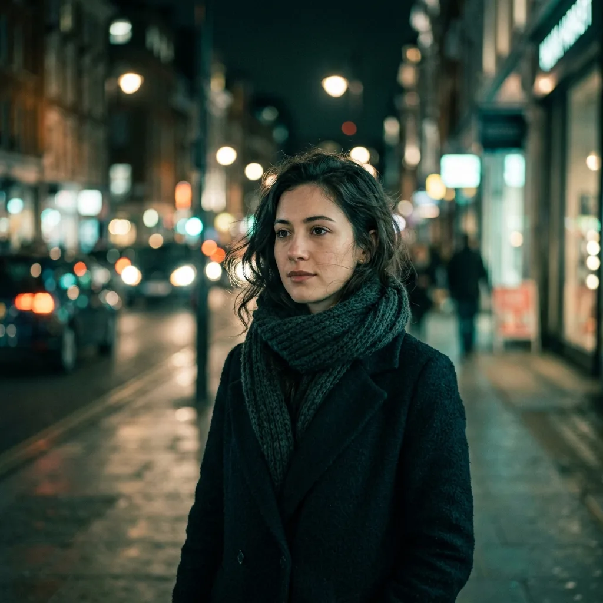

# Night-time portrait of a young woman standing outdoors, softly

[← Back to the collection](../../README.md) · Category: [Photography](../../gallery/photography.md) · Model: `Vinano Image v2` · ID: `vn-00388`

<a href="https://vinano.ai?utm_source=github&utm_medium=readme&utm_campaign=awesome-image-video-prompts-updating&utm_content=prompt-page-image"></a>

<sub>Preview generated with <a href="https://vinano.ai?utm_source=github&utm_medium=readme&utm_campaign=awesome-image-video-prompts-updating&utm_content=prompt-page-caption">vinano.ai</a></sub>

## Prompt

```text
A cinematic night-time portrait of a young woman standing outdoors, softly lit by ambient city lights. She wears a dark elegant coat a thick wool scarf wrapped around her neck. Loose strands of hair gently blown by the wind frame her face. Moody teal-green color grading, soft filmic, cinematic lighting, shallow depth of field, creamy bokeh city lights glowing in the background. Calm, introspective expression, natural skin texture, subtle makeup, film-like softness, atmospheric and emotional tone. Shot on a fast lens (85mm f/1.4 look), ultra-realistic photography, high detail, low noise, 8K quality. Keep edges clean and the overall composition balanced for a polished, gallery-ready result.
```

## Try it on vinano.ai

1. Copy the prompt above.
2. Open **[vinano.ai](https://vinano.ai?utm_source=github&utm_medium=readme&utm_campaign=awesome-image-video-prompts-updating&utm_content=prompt-page-try)**, paste it into the image generator and pick a model.
3. Swap any placeholders (brand, product, city, person…) for your own details, then generate.

More prompts like this: [Photography gallery](../../gallery/photography.md) · [all categories](../../README.md#contents)
