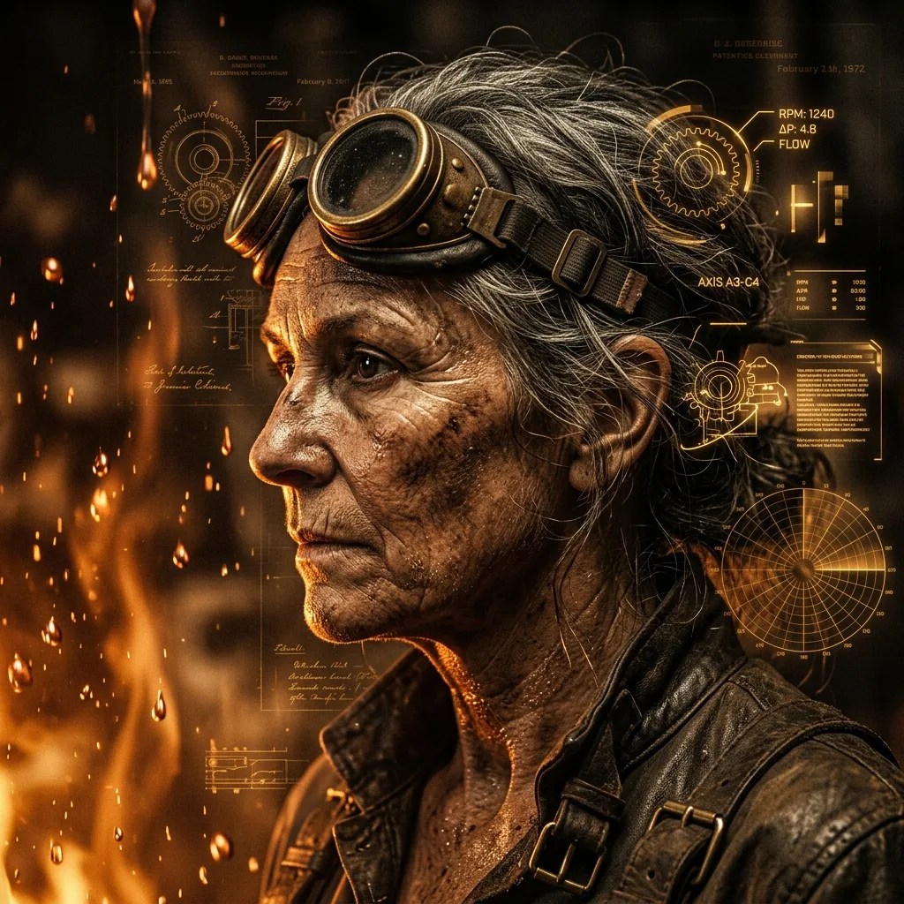

# Close-up profile of a weathered women a salt-and-pepper face

[← Back to the collection](../../README.md) · Category: [Photography](../../gallery/photography.md) · Model: `Vinano Image v2` · ID: `vn-00390`

<a href="https://vinano.ai?utm_source=github&utm_medium=readme&utm_campaign=awesome-image-video-prompts-updating&utm_content=prompt-page-image"></a>

<sub>Preview generated with <a href="https://vinano.ai?utm_source=github&utm_medium=readme&utm_campaign=awesome-image-video-prompts-updating&utm_content=prompt-page-caption">vinano.ai</a></sub>

## Prompt

```text
A cinematic close-up profile of a weathered women a salt-and-pepper face, wearing brass-rimmed aviator goggles pushed up. Low-key lighting a heavy amber glow; thick molten copper droplets and incandescent heat waves shimmering in the air. Dark, soot-stained background layered vintage patent blueprints, floating golden gear-ratio calculations, and radial HUD overlays. High contrast, grit-textured skin, hyper-realistic sweat beads, heavy industrial atmosphere, cinematic sepia grading, 8K, epic digital concept art.. Render with rich micro-detail while keeping the layout uncluttered and intentional.
```

## Try it on vinano.ai

1. Copy the prompt above.
2. Open **[vinano.ai](https://vinano.ai?utm_source=github&utm_medium=readme&utm_campaign=awesome-image-video-prompts-updating&utm_content=prompt-page-try)**, paste it into the image generator and pick a model.
3. Swap any placeholders (brand, product, city, person…) for your own details, then generate.

More prompts like this: [Photography gallery](../../gallery/photography.md) · [all categories](../../README.md#contents)
