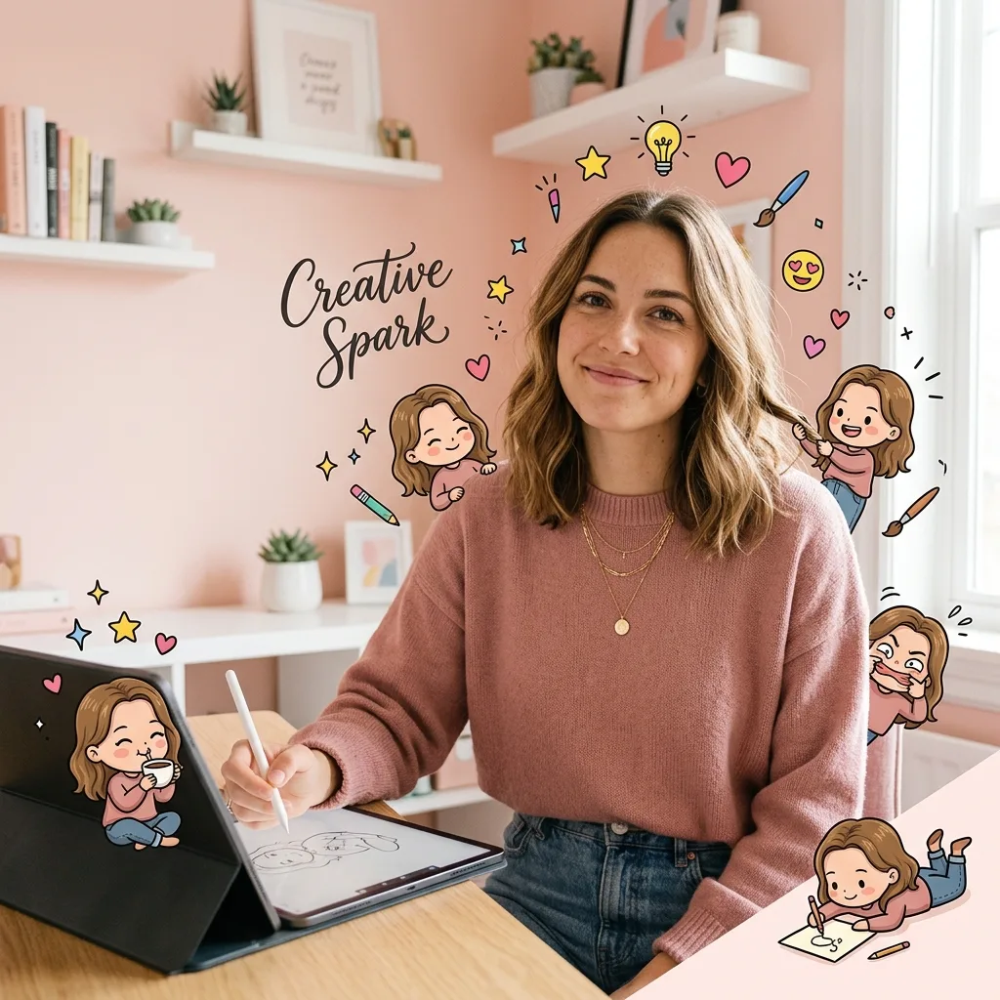

# Use the reference photo to create a realistic female

[← Back to the collection](../../README.md) · Category: [Photography](../../gallery/photography.md) · Model: `Vinano Image v2` · ID: `vn-00394`

<a href="https://vinano.ai?utm_source=github&utm_medium=readme&utm_campaign=awesome-image-video-prompts-updating&utm_content=prompt-page-image"></a>

<sub>Preview generated with <a href="https://vinano.ai?utm_source=github&utm_medium=readme&utm_campaign=awesome-image-video-prompts-updating&utm_content=prompt-page-caption">vinano.ai</a></sub>

## Prompt

```text
Use the reference photo to create a realistic female character, soft smile, a fun and natural expression, without changing the facial structure or features, keeping it as realistic as possible.
Hair: Same as in the reference photo, natural movement and shine.
Outfit: Modern, stylish casual clothing.
Scene: Set in a cute pink office, showing her being creative. Around her, include mini chibi versions of herself doing funny actions (drinking coffee from a cup, pulling her hair, making silly faces, lying on her stomach on the desk drawing in a notebook). Add doodles and emojis, and include a matching phrase.
Lighting & Format: Natural light, aspect ratio 1080:1350 (4:5).

Aim for an editorial, design-driven look with deliberate negative space.
```

## Try it on vinano.ai

1. Copy the prompt above.
2. Open **[vinano.ai](https://vinano.ai?utm_source=github&utm_medium=readme&utm_campaign=awesome-image-video-prompts-updating&utm_content=prompt-page-try)**, paste it into the image generator and pick a model.
3. Swap any placeholders (brand, product, city, person…) for your own details, then generate.

More prompts like this: [Photography gallery](../../gallery/photography.md) · [all categories](../../README.md#contents)
