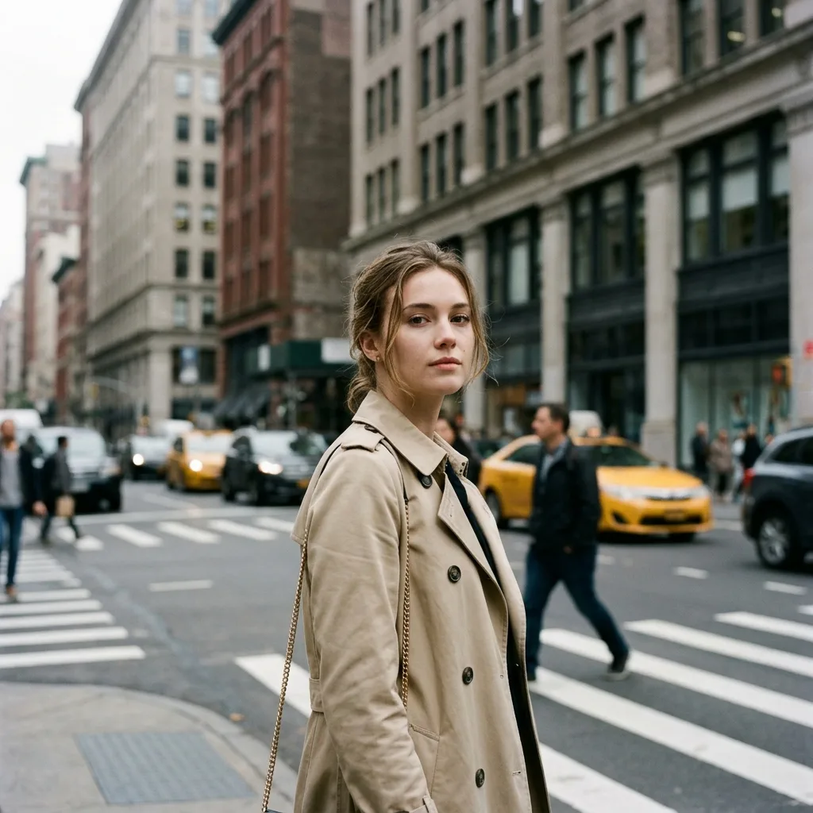

# Busy urban crosswalk

[← Back to the collection](../../README.md) · Category: [Photography](../../gallery/photography.md) · Model: `Vinano Image v2` · ID: `vn-00398`

<a href="https://vinano.ai?utm_source=github&utm_medium=readme&utm_campaign=awesome-image-video-prompts-updating&utm_content=prompt-page-image"></a>

<sub>Preview generated with <a href="https://vinano.ai?utm_source=github&utm_medium=readme&utm_campaign=awesome-image-video-prompts-updating&utm_content=prompt-page-caption">vinano.ai</a></sub>

## Prompt

```text
{
 "Objective": "Create a realistic candid street photograph cinematic documentary realism",
 "PersonaDetails": {
 "Subject": {
 "Type": "Young woman",
 "Pose": "Standing at a city crosswalk, captured mid-turn",
 "Gaze": "Looking directly toward the camera",
 "Expression": "Calm, introspective, slightly distant",
 "Hair": "Loosely tied back soft strands framing the face",
 "Wardrobe": {
 "Outerwear": "Beige trench coat",
 "Accessories": "Thin gold chain shoulder bag"
 }
 }
 },
 "SceneDescription": {
 "Location": "Busy urban crosswalk",
 "BackgroundElements": ["Pedestrians in motion",
 "Yellow taxis",
 "Tall city buildings"],
 "Motion": "Subtle background movement suggesting city life"
 },
 "Composition": {
 "Framing": "Waist-up candid framing",
 "Moment": "Unposed, spontaneous mid-turn capture",
 "DepthOfField": "Shallow depth of field",
 "Focus": "Ultra-sharp subject background motion blur"
 },
 "LightingAndColor": {
 "Lighting": "Natural overcast daylight",
 "ColorPalette": "Muted neutral tones",
 "Bokeh": "Soft cinematic bokeh"
 },
 "PhotographyStyle": {
 "Genre": "Street photography",
 "Aesthetic": "Documentary-style realism",
 "LensLook": "85mm lens perspective",
 "DetailLevel": "High detail, true-to-life photorealistic textures"
 },
 "Mood": {
 "Tone": "Quiet, reflective, urban",
 "Atmosphere": "Authentic, lived-in city moment"
 },
 "ArtDirection": {
 "Style": "true-to-life photorealistic",
 "RealismLevel": "True-to-life, candid capture",
 "Processing": "Minimal, natural post-processing"
 },
 "NegativePrompt": ["posed look",
 "fashion editorial",
 "studio lighting",
 "oversaturated colors",
 "heavy retouching",
 "cartoon",
 "anime",
 "blurry subject"],
 "ResponseFormat": {
 "Type": "Single image",
 "Orientation": "Portrait",
 "AspectRatio": "2:3"
 }
}

Preserve realistic proportions and depth for a confident, professional finish.
```

## Try it on vinano.ai

1. Copy the prompt above.
2. Open **[vinano.ai](https://vinano.ai?utm_source=github&utm_medium=readme&utm_campaign=awesome-image-video-prompts-updating&utm_content=prompt-page-try)**, paste it into the image generator and pick a model.
3. Swap any placeholders (brand, product, city, person…) for your own details, then generate.

More prompts like this: [Photography gallery](../../gallery/photography.md) · [all categories](../../README.md#contents)
