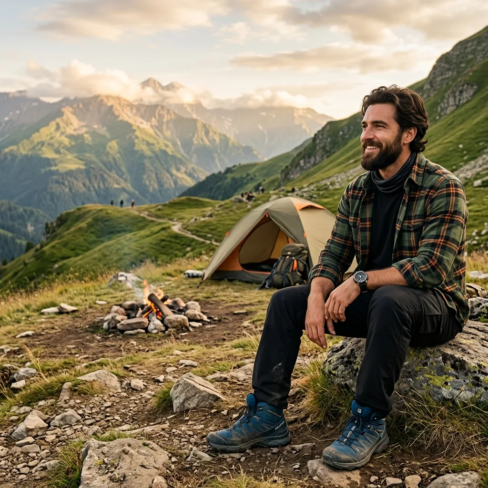

# Photography prompt #405

[← Back to the collection](../../README.md) · Category: [Photography](../../gallery/photography.md) · Model: `Vinano Image v2` · ID: `vn-00405`

<a href="https://vinano.ai?utm_source=github&utm_medium=readme&utm_campaign=awesome-image-video-prompts-updating&utm_content=prompt-page-image"></a>

<sub>Preview generated with <a href="https://vinano.ai?utm_source=github&utm_medium=readme&utm_campaign=awesome-image-video-prompts-updating&utm_content=prompt-page-caption">vinano.ai</a></sub>

## Prompt

```text
{
 "prompt_details": {
 "subject": {
 "description": "Handsome male trekker, dark wavy hair (no cap), full beard, rugged appearance",
 "expression": "Relaxed, calm, enjoying the nature",
 "clothing": "Green check flannel shirt layered over a black T-shirt, black cargo trekking pants, blue hiking boots, wristwatch, neck gaiter"
 },
 "environment": {
 "location": "Mountain campsite",
 "elements": "Pitched camping tent in background, lush green hills, rocky ground, perhaps a small campfire",
 "time_of_day": "Golden hour or soft afternoon light"
 },
 "style": {
 "type": "Hyper-realistic outdoor photography",
 "quality": "8k resolution, filmic, cinematic lighting, sharp focus, detailed texture",
 "camera_angle": "Eye-level or slightly low angle"
 }
 },
 "full_prompt_text": "A handsome male trekker sitting comfortably at a mountain campsite, no cap, showing dark wavy hair and a beard. He is wearing a green check shirt over a black t-shirt, black cargo pants, and blue hiking boots. A camping tent is visible in the background amidst lush green mountains. Soft natural lighting, realistic skin texture, cinematic outdoor adventure style, 8k resolution."
}

Aim for an editorial, design-driven look with deliberate negative space.
```

## Try it on vinano.ai

1. Copy the prompt above.
2. Open **[vinano.ai](https://vinano.ai?utm_source=github&utm_medium=readme&utm_campaign=awesome-image-video-prompts-updating&utm_content=prompt-page-try)**, paste it into the image generator and pick a model.
3. Swap any placeholders (brand, product, city, person…) for your own details, then generate.

More prompts like this: [Photography gallery](../../gallery/photography.md) · [all categories](../../README.md#contents)
