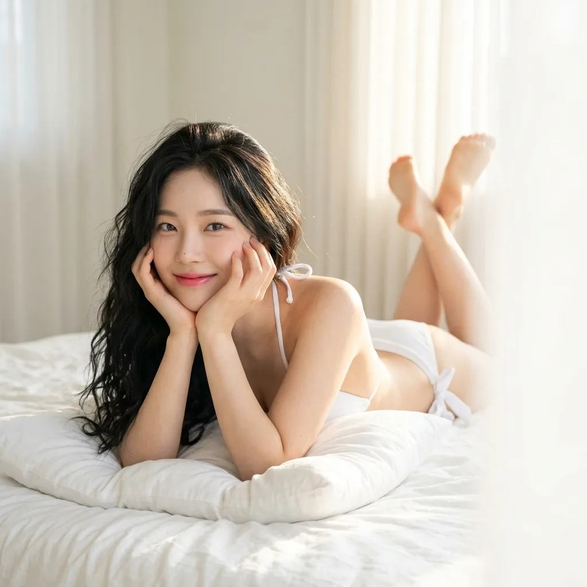

# Photography prompt #406

[← Back to the collection](../../README.md) · Category: [Photography](../../gallery/photography.md) · Model: `Vinano Image v2` · ID: `vn-00406`

<a href="https://vinano.ai?utm_source=github&utm_medium=readme&utm_campaign=awesome-image-video-prompts-updating&utm_content=prompt-page-image"></a>

<sub>Preview generated with <a href="https://vinano.ai?utm_source=github&utm_medium=readme&utm_campaign=awesome-image-video-prompts-updating&utm_content=prompt-page-caption">vinano.ai</a></sub>

## Prompt

```text
(Masterpiece, Best Quality, 8K UHD, RAW photo), true-to-life photorealistic portrait,
 the exact same beautiful Korean female k-pop idol every time,
 innocent baby face, straight eyebrows, big doe eyes aegyosal,
 gradient glossy pink lips, light blush,
 messy long black wavy hair fanning out across the white pillow,
 sun-kissed highlights on select strands,

 Layer 2: white string bikini top, tied at back of neck,
 Layer 5 white string bikini bottom side bows,
 bare legs slightly bent at the knees, feet crossed in the air,
 lying on her stomach on a white bed,
 propped up on elbows, chin resting on hands,
 legs lazily crossed and kicked up behind her,
 shoulders relaxed and open,
 natural effortless sensual pose, maximum breathing space in composition,
 looking back over her shoulder at the camera,
 playful smile, eyes bright and inviting,
 expression: carefree, natural beauty, innocent allure,
 relaxed brow, slight head tilt,

 white bed soft rumpled linen sheets,
 one white pillow beneath her elbows,
 sheer white curtains morning light pouring through,
 large overexposed white background area on the right side,
 strong negative space for breathing room,
 dreamy hazy soft-focus atmosphere,

 golden morning sunlight from the right side through sheer curtains,
 warm light illuminating her face and upper body,
 soft shadows, high-key overall,
 dust motes floating in light beams,
 gentle hair backlight creating angelic glow,

 Canon R5, 50mm f/1.4,
 eye-level intimate POV,
 moderate depth of field, soft bokeh on background,
 sharp focus on eyes and face,

 airy, luminous, dreamy morning atmosphere,
 youthful sensuality, effortless beauty,

 ultra-detailed skin, realistic hair strands, fabric texture,
 8K resolution, true-to-life photorealistic, no artifacts, no watermark

Keep edges clean and the overall composition balanced for a polished, gallery-ready result.
```

## Try it on vinano.ai

1. Copy the prompt above.
2. Open **[vinano.ai](https://vinano.ai?utm_source=github&utm_medium=readme&utm_campaign=awesome-image-video-prompts-updating&utm_content=prompt-page-try)**, paste it into the image generator and pick a model.
3. Swap any placeholders (brand, product, city, person…) for your own details, then generate.

More prompts like this: [Photography gallery](../../gallery/photography.md) · [all categories](../../README.md#contents)
