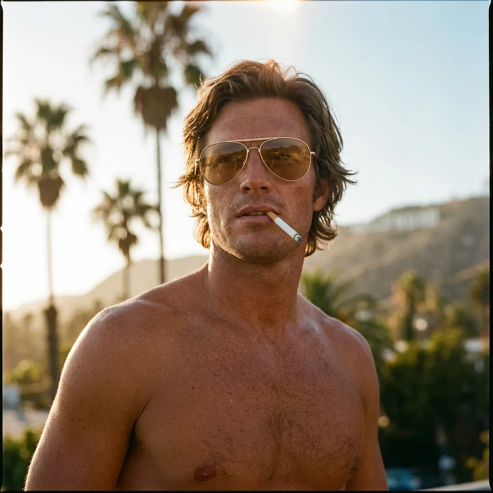

# Shirtless male subject, hyper-realistic skin texture, deep tan, 1970s

[← Back to the collection](../../README.md) · Category: [Photography](../../gallery/photography.md) · Model: `Vinano Image v2` · ID: `vn-00413`

<a href="https://vinano.ai?utm_source=github&utm_medium=readme&utm_campaign=awesome-image-video-prompts-updating&utm_content=prompt-page-image"></a>

<sub>Preview generated with <a href="https://vinano.ai?utm_source=github&utm_medium=readme&utm_campaign=awesome-image-video-prompts-updating&utm_content=prompt-page-caption">vinano.ai</a></sub>

## Prompt

```text
Shirtless male subject, hyper-realistic skin texture, deep tan, 1970s Hollywood aesthetic, vintage gold-rimmed aviator sunglasses amber tint, unlit cigarette held in mouth, masculine ruggedness, medium close-up, low-angle perspective, background of blurred palm trees and hazy Los Angeles hillside, high-key natural sunlight, warm tungsten glow, golden hour color grading, shot on 35mm film, Arriflex 35 BL, 50mm T1.3, heavy film grain, authentic Kodak Portra 400 stock, slight lens flare, sun-bleached highlights, retro film-still style, directed by Quentin Tarantino Preserve realistic proportions and depth for a confident, professional finish.
```

## Try it on vinano.ai

1. Copy the prompt above.
2. Open **[vinano.ai](https://vinano.ai?utm_source=github&utm_medium=readme&utm_campaign=awesome-image-video-prompts-updating&utm_content=prompt-page-try)**, paste it into the image generator and pick a model.
3. Swap any placeholders (brand, product, city, person…) for your own details, then generate.

More prompts like this: [Photography gallery](../../gallery/photography.md) · [all categories](../../README.md#contents)
