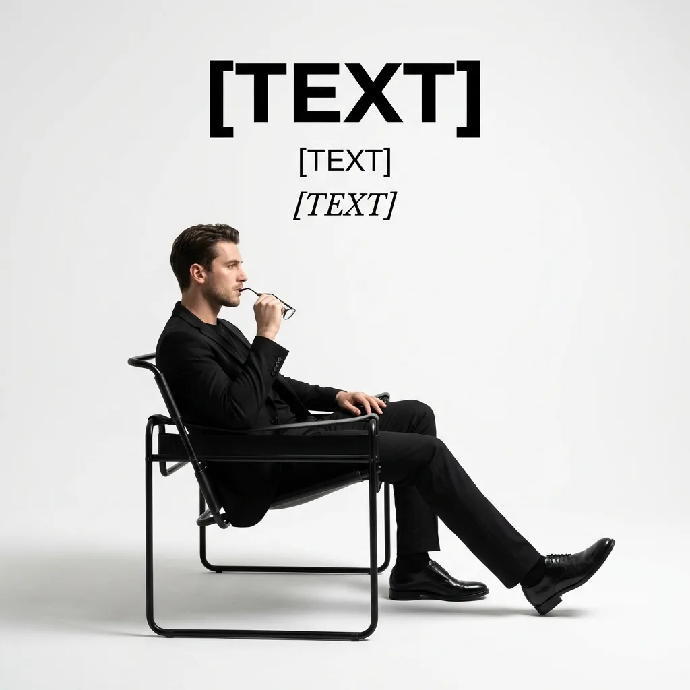

# Refined minimalist studio photograph fashion ad

[← Back to the collection](../../README.md) · Category: [Photography](../../gallery/photography.md) · Model: `Vinano Image v2` · ID: `vn-00421`

<a href="https://vinano.ai?utm_source=github&utm_medium=readme&utm_campaign=awesome-image-video-prompts-updating&utm_content=prompt-page-image"></a>

<sub>Preview generated with <a href="https://vinano.ai?utm_source=github&utm_medium=readme&utm_campaign=awesome-image-video-prompts-updating&utm_content=prompt-page-caption">vinano.ai</a></sub>

## Prompt

```text
A refined minimalist studio photograph fashion ad. At the top center, the bold sans-serif text "[TEXT]" is positioned above the smaller sans-serif text "[TEXT]", which is above the italic script text "[TEXT]". Below the text, a man in a black suit, black t-shirt, and polished black dress shoes sits in profile, facing left. He is seated in a modern chair a black leather seat and backrest suspended on a tubular black metal frame. His right leg is extended, and he holds a pair of glasses in his right hand near his mouth. The background and floor are a seamless, stark white studio space soft, diffused lighting that casts grounded shadows beneath the man and chair. Emphasise material texture and natural light so the final frame feels tactile and premium.
```

## Try it on vinano.ai

1. Copy the prompt above.
2. Open **[vinano.ai](https://vinano.ai?utm_source=github&utm_medium=readme&utm_campaign=awesome-image-video-prompts-updating&utm_content=prompt-page-try)**, paste it into the image generator and pick a model.
3. Swap any placeholders (brand, product, city, person…) for your own details, then generate.

More prompts like this: [Photography gallery](../../gallery/photography.md) · [all categories](../../README.md#contents)
