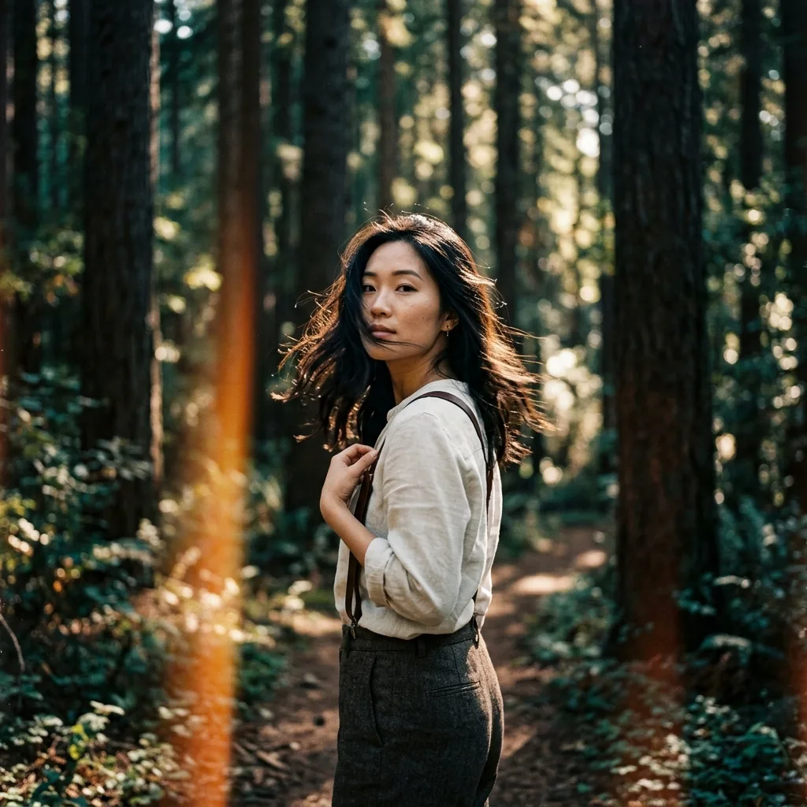

# Portrait of an Asian woman standing in a quiet

[← Back to the collection](../../README.md) · Category: [Photography](../../gallery/photography.md) · Model: `Vinano Image v2` · ID: `vn-00425`

<a href="https://vinano.ai?utm_source=github&utm_medium=readme&utm_campaign=awesome-image-video-prompts-updating&utm_content=prompt-page-image"></a>

<sub>Preview generated with <a href="https://vinano.ai?utm_source=github&utm_medium=readme&utm_campaign=awesome-image-video-prompts-updating&utm_content=prompt-page-caption">vinano.ai</a></sub>

## Prompt

```text
A cinematic portrait of an Asian woman standing in a quiet forest, captured in a spontaneous moment as she turns her head slightly back toward the camera. Soft sunlight filters through tall trees, creating dramatic patches of light and shadow across her face and body. A distinct vertical light leak streak cuts through the frame, adding a striking analog imperfection. Her hair moves gently in the breeze, loose strands catching the light, adding natural motion and softness. She wears a simple light-colored blouse layered dark suspenders, creating a subtle contrast against the deep forest tones. Her expression is calm, slightly distant, and introspective, her eyes softly meeting the camera. The background is filled blurred tree trunks and glowing bokeh highlights, creating depth and atmosphere. The color grading features rich teal shadows and warm orange highlights, giving a cinematic teal-and-orange contrast. The image has a strong analog film aesthetic visible grain, soft haze, slight blur, and light distortion. Imperfect framing, natural light flare, and film burn elements enhance the nostalgic 35mm film look. Cinematic film still, dreamy and moody atmosphere, poetic forest setting, high detail, hd quality. Preserve realistic proportions and depth for a confident, professional finish.
```

## Try it on vinano.ai

1. Copy the prompt above.
2. Open **[vinano.ai](https://vinano.ai?utm_source=github&utm_medium=readme&utm_campaign=awesome-image-video-prompts-updating&utm_content=prompt-page-try)**, paste it into the image generator and pick a model.
3. Swap any placeholders (brand, product, city, person…) for your own details, then generate.

More prompts like this: [Photography gallery](../../gallery/photography.md) · [all categories](../../README.md#contents)
