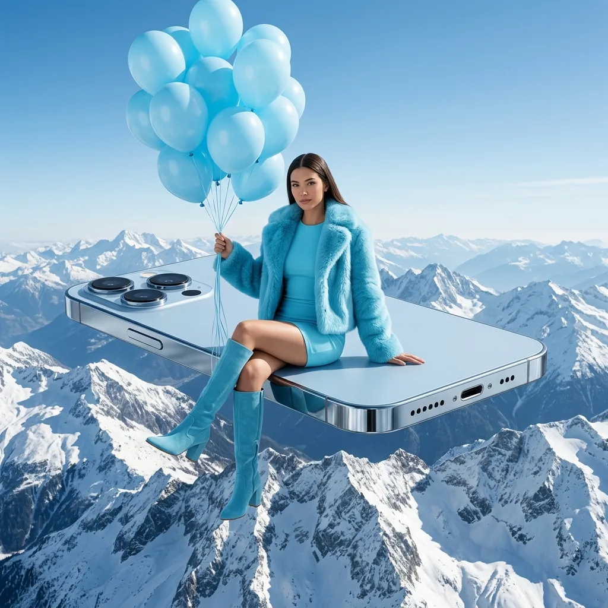

# Surreal, high-concept masterpiece featuring “uploaded face as reference” seated

[← Back to the collection](../../README.md) · Category: [Photography](../../gallery/photography.md) · Model: `Vinano Image v2` · ID: `vn-00427`

<a href="https://vinano.ai?utm_source=github&utm_medium=readme&utm_campaign=awesome-image-video-prompts-updating&utm_content=prompt-page-image"></a>

<sub>Preview generated with <a href="https://vinano.ai?utm_source=github&utm_medium=readme&utm_campaign=awesome-image-video-prompts-updating&utm_content=prompt-page-caption">vinano.ai</a></sub>

## Prompt

```text
A surreal, high-concept masterpiece featuring “uploaded face as reference” seated casually on the edge of a colossal, floating smartphone suspended high above a snow-capped mountain range. The subject is dressed in a monochromatic cyan ensemble, wearing a fitted mini dress, a plush faux-fur jacket, and knee-high suede boots, while holding a large cluster of matching light-blue helium balloons.

The giant smartphone, resembling a high-end device a triple-lens camera array and metallic silver edges, floats horizontally, displaying realistic charging ports and speaker grills. Bright, crisp daylight casts sharp shadows on the phone’s surface, highlighting the texture of the fur and the sleek glass.

The background is a breathtaking aerial vista of jagged, snowy alpine peaks under a clear blue sky, rendered in 8K resolution hyper-realistic textures, deep depth of field, and a commercial photography aesthetic.

Aim for an editorial, design-driven look with deliberate negative space.
```

## Try it on vinano.ai

1. Copy the prompt above.
2. Open **[vinano.ai](https://vinano.ai?utm_source=github&utm_medium=readme&utm_campaign=awesome-image-video-prompts-updating&utm_content=prompt-page-try)**, paste it into the image generator and pick a model.
3. Swap any placeholders (brand, product, city, person…) for your own details, then generate.

More prompts like this: [Photography gallery](../../gallery/photography.md) · [all categories](../../README.md#contents)
