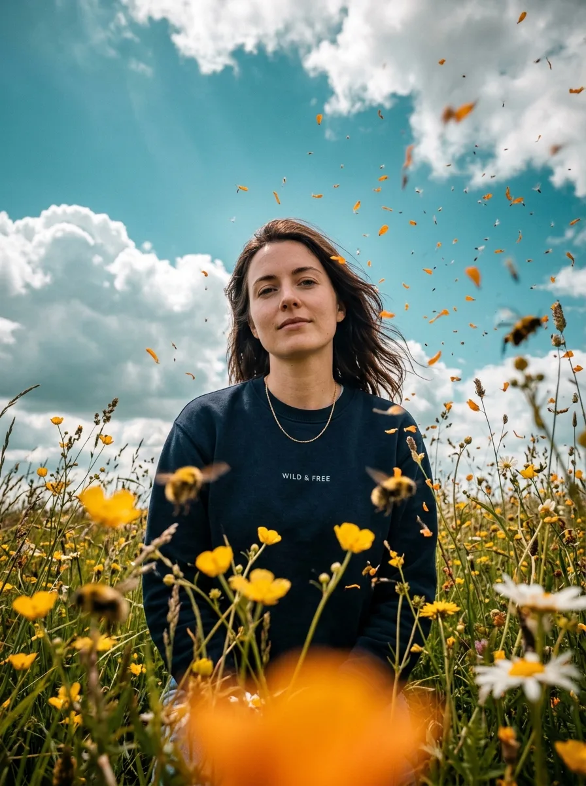

# True-to-life photorealistic cinematic photo, 3:4 vertical frame, shooting

[← Back to the collection](../../README.md) · Category: [Photography](../../gallery/photography.md) · Model: `Vinano Image v2` · ID: `vn-00442`

<a href="https://vinano.ai?utm_source=github&utm_medium=readme&utm_campaign=awesome-image-video-prompts-updating&utm_content=prompt-page-image"></a>

<sub>Preview generated with <a href="https://vinano.ai?utm_source=github&utm_medium=readme&utm_campaign=awesome-image-video-prompts-updating&utm_content=prompt-page-caption">vinano.ai</a></sub>

## Prompt

```text
true-to-life photorealistic cinematic photo, 3:4 vertical frame, shooting from a very low point of grass/flowers (worm's-eye view) on a wide-angle lens-24-28mm. In the center of the frame, chest-deep, is a 25-year-old young woman fair skin and dark brown hair, wearing a dark blue/black sweatshirt a small white inscription on the chest, and a thin chain around his neck. The pose is calm, the body is slightly

turned to the right, the head looks straight at the viewer and is raised; the focus is on the upper body. Foreground: large blurred yellow bees, yellow flowers and green stems, strong sideways, one large warm orange glare/spot at the bottom of the frame. Middle ground: around the model there are wild plants and flowers, some of the stems are sharp, some are in a soft blur.

Background/sky: a large turquoise-blue open sky large white cumulus clouds on the left and above. There are a lot of small orange petals/seeds/leaves in the air above and around the model, as if they were picked up by the wind; they are at different distances and partially blurred (motion blur + shallow DOF), creating the effect of "floating particles".

Lighting: natural daylight, the sun is high / slightly behind on the left; soft contour illumination of hair and shoulders, sun is on accents + cool sky, light teal-orange grading, moderate vignette.

Parameters/style: shallow depth of field, foreground bokeh, crisp subject, cinematic, ultra realistic, high detail, natural film look, slight haze, no text overlays, no logos, no watermark.

Negative promt: illustration, CGI, cartoon, plastic skin, overexposure, strong noise, dirty background, superfluous people, buildings, wires, large readable inscriptions on clothes, artifacts, deformity of arms/shoulders.

Render with rich micro-detail while keeping the layout uncluttered and intentional.
```

## Try it on vinano.ai

1. Copy the prompt above.
2. Open **[vinano.ai](https://vinano.ai?utm_source=github&utm_medium=readme&utm_campaign=awesome-image-video-prompts-updating&utm_content=prompt-page-try)**, paste it into the image generator and pick a model.
3. Swap any placeholders (brand, product, city, person…) for your own details, then generate.

More prompts like this: [Photography gallery](../../gallery/photography.md) · [all categories](../../README.md#contents)
