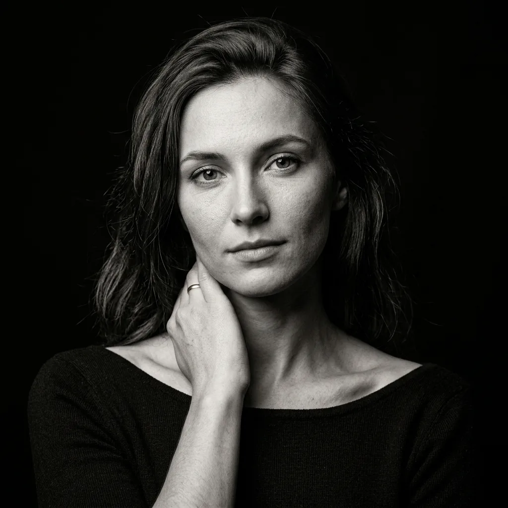

# High-contrast monochromatic studio portrait of a European woman around

[← Back to the collection](../../README.md) · Category: [Photography](../../gallery/photography.md) · Model: `Vinano Image v2` · ID: `vn-00446`

<a href="https://vinano.ai?utm_source=github&utm_medium=readme&utm_campaign=awesome-image-video-prompts-updating&utm_content=prompt-page-image"></a>

<sub>Preview generated with <a href="https://vinano.ai?utm_source=github&utm_medium=readme&utm_campaign=awesome-image-video-prompts-updating&utm_content=prompt-page-caption">vinano.ai</a></sub>

## Prompt

```text
{
"prompt": "High-contrast monochromatic studio portrait of a European woman around 25 years old. She has natural facial proportions, delicate cheekbones, expressive eyes, and realistic skin texture visible pores and fine detail. Her expression is calm, elegant, and confident, looking softly toward the camera. She is posed gracefully one hand lightly touching her neck and shoulders slightly angled. She is wearing a simple elegant black dress that softly frames her collarbones and shoulders. Hair is natural and softly styled visible strand detail. Use minimal modern studio lighting a single focused key light slightly above eye level, creating soft sculpted highlights on the face and subtle shadows for depth. Background is pure black, clean and textureless. Composition is a tight head-and-shoulders portrait sharp focus on the eyes and shallow depth of field. Style: cinematic fine-art monochrome photography, modern editorial studio aesthetic, ultra-realistic, high contrast, 8K resolution, sharp micro-details."
}

Emphasise material texture and natural light so the final frame feels tactile and premium.
```

## Try it on vinano.ai

1. Copy the prompt above.
2. Open **[vinano.ai](https://vinano.ai?utm_source=github&utm_medium=readme&utm_campaign=awesome-image-video-prompts-updating&utm_content=prompt-page-try)**, paste it into the image generator and pick a model.
3. Swap any placeholders (brand, product, city, person…) for your own details, then generate.

More prompts like this: [Photography gallery](../../gallery/photography.md) · [all categories](../../README.md#contents)
