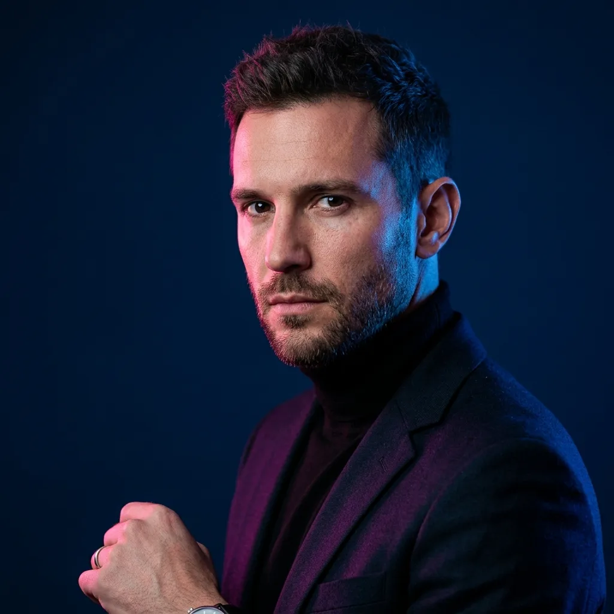

# Medium close-up portrait of the reference person, slightly turned

[← Back to the collection](../../README.md) · Category: [Photography](../../gallery/photography.md) · Model: `Vinano Image v2` · ID: `vn-00450`

<a href="https://vinano.ai?utm_source=github&utm_medium=readme&utm_campaign=awesome-image-video-prompts-updating&utm_content=prompt-page-image"></a>

<sub>Preview generated with <a href="https://vinano.ai?utm_source=github&utm_medium=readme&utm_campaign=awesome-image-video-prompts-updating&utm_content=prompt-page-caption">vinano.ai</a></sub>

## Prompt

```text
Ultra-realistic cinematic medium close-up portrait of the reference person, slightly turned to the side while looking toward the camera. Wearing a black turtleneck and dark jacket, modern and refined minimalist fashion style. Deep blue background a smooth gradient, combined contrasting magenta and blue lighting. Strong blue light coming from one side and magenta light from the opposite side, both colors reflecting clearly on the face and skin, creating a dramatic color contrast. High-end editorial lighting, sharp focus, realistic skin texture, cinematic mood, shallow depth of field. Aim for an editorial, design-driven look with deliberate negative space.
```

## Try it on vinano.ai

1. Copy the prompt above.
2. Open **[vinano.ai](https://vinano.ai?utm_source=github&utm_medium=readme&utm_campaign=awesome-image-video-prompts-updating&utm_content=prompt-page-try)**, paste it into the image generator and pick a model.
3. Swap any placeholders (brand, product, city, person…) for your own details, then generate.

More prompts like this: [Photography gallery](../../gallery/photography.md) · [all categories](../../README.md#contents)
