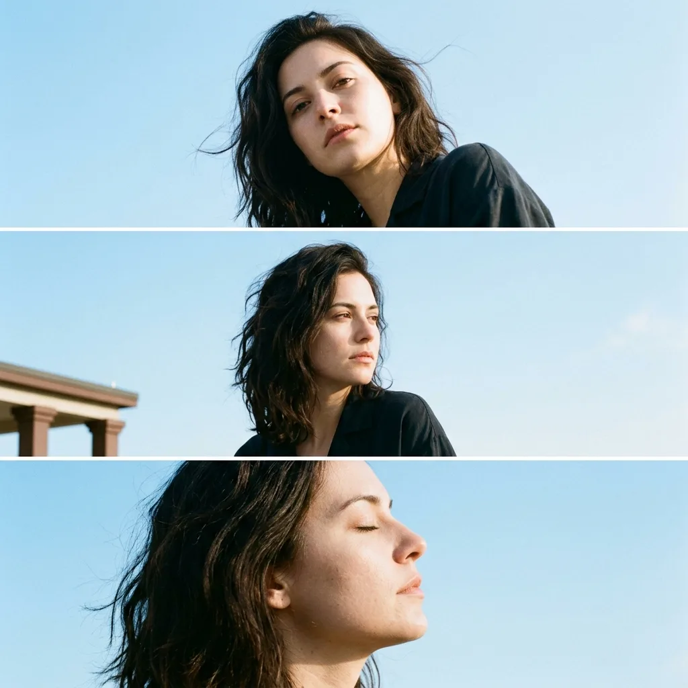

# Dark, tousled hair

[← Back to the collection](../../README.md) · Category: [Photography](../../gallery/photography.md) · Model: `Vinano Image Pro` · ID: `vn-00460`

<a href="https://vinano.ai?utm_source=github&utm_medium=readme&utm_campaign=awesome-image-video-prompts-updating&utm_content=prompt-page-image"></a>

<sub>Preview generated with <a href="https://vinano.ai?utm_source=github&utm_medium=readme&utm_campaign=awesome-image-video-prompts-updating&utm_content=prompt-page-caption">vinano.ai</a></sub>

## Prompt

```text
{
 "type": "image_generation_prompt",
 "format": "triptych",
 "aspect_ratio": "vertical, three stacked panels",
 "identity_preservation": {
 "use_original_image_reference": true,
 "strict_identity_lock": true,
 "face_changes_allowed": false,
 "clothing_changes_allowed": false,
 "notes": "Maintain 100% original facial structure, proportions, moles, eyes, nose, mouth, skin texture, hairstyle, and original clothing exactly as in the reference image."
 },
 "subject": {
 "gender": "female",
 "appearance": {
 "hair": {
 "style": "dark, tousled hair",
 "details": "natural movement a few strands lifted by breeze"
 },
 "expression_style": "natural, candid, introspective"
 }
 },
 "composition": {
 "layout": "three vertically stacked photographs (triptych)",
 "background": "bright, clear blue sky",
 "setting": "outdoor, rooftop-like environment"
 },
 "panels": {
 "top_panel": {
 "camera_angle": "low angle",
 "pose": "looking down toward the camera",
 "expression": "direct, slightly pensive gaze",
 "lighting": "bright sunlight illuminating one side of face and shoulder soft shadows"
 },
 "middle_panel": {
 "camera_angle": "eye-level to slightly low",
 "pose": "head turned away, gazing to the right",
 "expression": "thoughtful, distant",
 "environment_detail": "small portion of brown columned roof visible in lower left",
 "composition_note": "subject slightly off-center emphasizing open sky"
 },
 "bottom_panel": {
 "camera_angle": "close-up profile",
 "pose": "eyes closed, head slightly tilted back",
 "expression": "calm, reflective",
 "lighting": "sunlight accentuating facial and neck contours"
 }
 },
 "camera": {
 "type": "35mm film camera aesthetic",
 "lens_aperture": "f/1.8–f/2.8",
 "focus": "sharp focus on face shallow depth of field",
 "grain": "visible natural film grain"
 },
 "lighting": {
 "source": "natural daylight",
 "time_of_day": "afternoon",
 "quality": "soft, diffused sunlight",
 "direction": "front and side lighting",
 "artificial_light": "none"
 },
 "color_and_style": {
 "palette": ["vivid blue sky",
 "warm natural skin tones"],
 "style": "editorial portrait analog film aesthetic",
 "atmosphere": "calm, airy, serene, nostalgic",
 "contrast": "subtle",
 "saturation": "natural slight enhancement"
 },
 "quality": {
 "realism": "high",
 "detail": "natural skin texture, realistic lighting",
 "imperfections": "preserved"
 },
 "constraints": ["No facial alterations",
 "No clothing changes",
 "No artificial lighting",
 "No digital beauty filters",
 "No CGI or illustration",
 "No text or watermarks"],
 "output_goal": "Create a serene, film-like triptych portrait of the same woman against a clear blue sky, preserving her exact identity, clothing, and natural expressions an airy editorial and analog aesthetic."
}

Render with rich micro-detail while keeping the layout uncluttered and intentional.
```

## Try it on vinano.ai

1. Copy the prompt above.
2. Open **[vinano.ai](https://vinano.ai?utm_source=github&utm_medium=readme&utm_campaign=awesome-image-video-prompts-updating&utm_content=prompt-page-try)**, paste it into the image generator and pick a model.
3. Swap any placeholders (brand, product, city, person…) for your own details, then generate.

More prompts like this: [Photography gallery](../../gallery/photography.md) · [all categories](../../README.md#contents)
