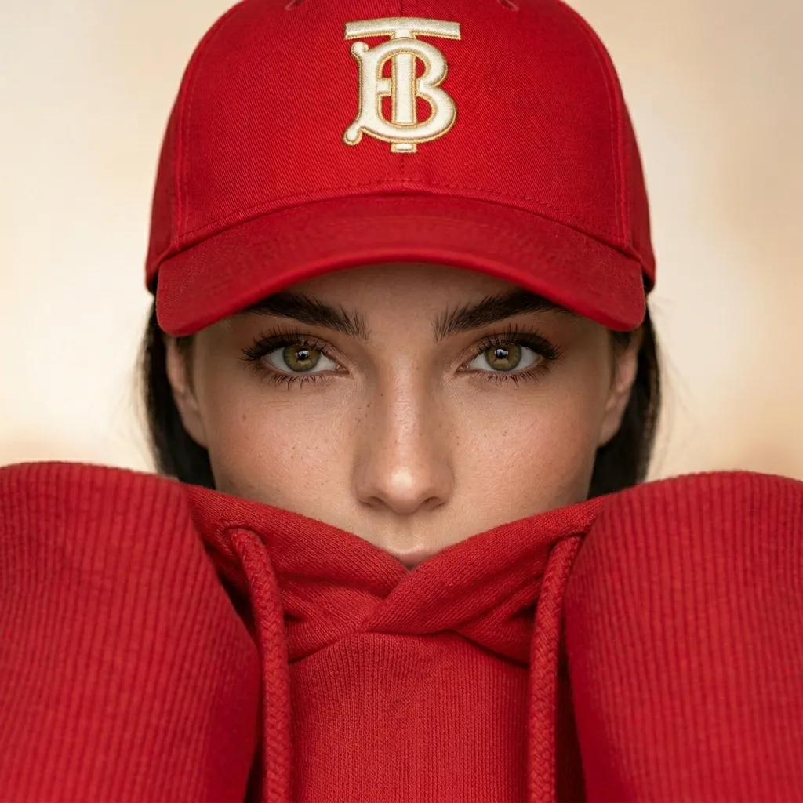

# Fashion beauty crop of a female model wearing

[← Back to the collection](../../README.md) · Category: [Photography](../../gallery/photography.md) · Model: `Vinano Image v2` · ID: `vn-00461`

<a href="https://vinano.ai?utm_source=github&utm_medium=readme&utm_campaign=awesome-image-video-prompts-updating&utm_content=prompt-page-image"></a>

<sub>Preview generated with <a href="https://vinano.ai?utm_source=github&utm_medium=readme&utm_campaign=awesome-image-video-prompts-updating&utm_content=prompt-page-caption">vinano.ai</a></sub>

## Prompt

```text
Ultra-realistic fashion beauty crop of a female model wearing the reference red baseball cap and matching red hoodie. Framing: Tight portrait crop from nose to forehead, cap and eyes filling the frame. Focus: The embroidered logo perfectly centered above the model’s eyes, stitching detail and thread depth clearly visible. Pose: Model gripping the hoodie collar softly both hands, creating subtle fabric folds. Lighting: Soft frontal studio light faint shadow sculpting on cheekbones and under the cap. Background: Minimal warm studio backdrop, ivory-to-beige gradient. Mood: Bold, confident, fashion-house campaign energy. Finish: Ultra-sharp fabric detail, cinematic realism, shallow depth of field, no text, no branding overlays. Keep edges clean and the overall composition balanced for a polished, gallery-ready result.
```

## Try it on vinano.ai

1. Copy the prompt above.
2. Open **[vinano.ai](https://vinano.ai?utm_source=github&utm_medium=readme&utm_campaign=awesome-image-video-prompts-updating&utm_content=prompt-page-try)**, paste it into the image generator and pick a model.
3. Swap any placeholders (brand, product, city, person…) for your own details, then generate.

More prompts like this: [Photography gallery](../../gallery/photography.md) · [all categories](../../README.md#contents)
