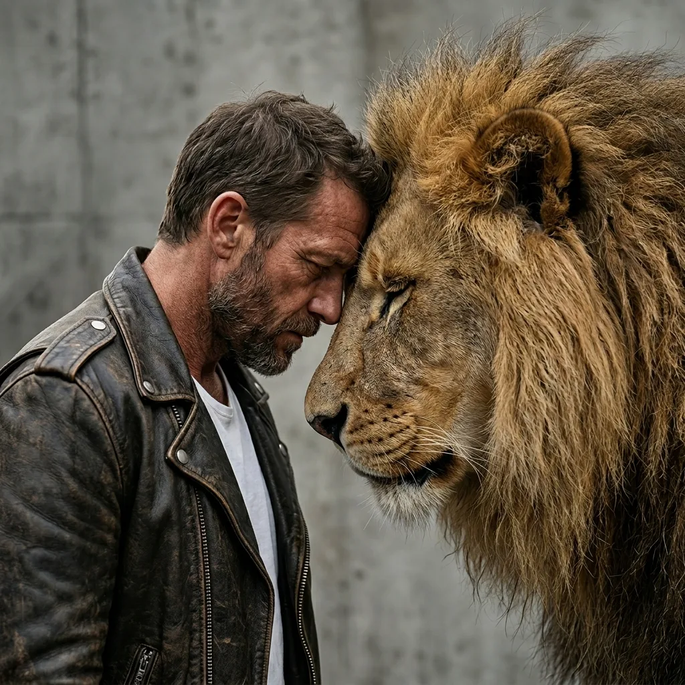

# Gritty, intense portrait of a man, a friend

[← Back to the collection](../../README.md) · Category: [Photography](../../gallery/photography.md) · Model: `Vinano Image Pro` · ID: `vn-00463`

<a href="https://vinano.ai?utm_source=github&utm_medium=readme&utm_campaign=awesome-image-video-prompts-updating&utm_content=prompt-page-image"></a>

<sub>Preview generated with <a href="https://vinano.ai?utm_source=github&utm_medium=readme&utm_campaign=awesome-image-video-prompts-updating&utm_content=prompt-page-caption">vinano.ai</a></sub>

## Prompt

```text
A gritty, intense portrait of a man, a friend of real lion, captured in a raw, hyper-realistic style. The background is a textured, neutral concrete wall, keeping the environment simple and industrial. Lighting is soft and diffuse, provided by a large octagon softbox, mimicking overcast daylight. The camera is a Canon EOS R5 an 85mm f/1.2 lens. The subject, the [face from reference image], is forehead-to-forehead the lion, displaying a deep bond. He wears a distressed leather motorcycle jacket and a white t-shirt, embracing a classic rebel aesthetic. The 8K image captures the pores on his skin and the coarse individual hairs of the lion's mane. The HDR aesthetic ensures vibrant colors and deep shadows, making the image feel three-dimensional and alive. Keep edges clean and the overall composition balanced for a polished, gallery-ready result.
```

## Try it on vinano.ai

1. Copy the prompt above.
2. Open **[vinano.ai](https://vinano.ai?utm_source=github&utm_medium=readme&utm_campaign=awesome-image-video-prompts-updating&utm_content=prompt-page-try)**, paste it into the image generator and pick a model.
3. Swap any placeholders (brand, product, city, person…) for your own details, then generate.

More prompts like this: [Photography gallery](../../gallery/photography.md) · [all categories](../../README.md#contents)
