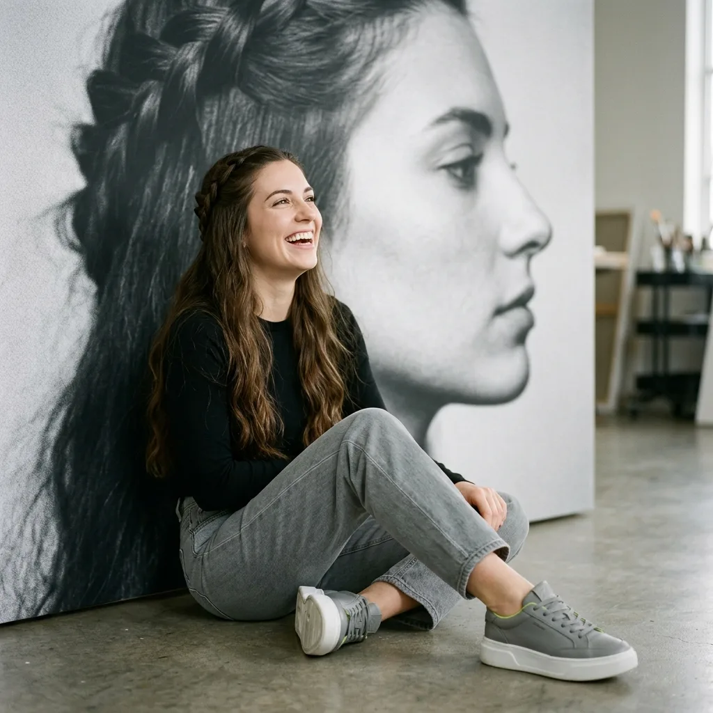

# Provided photos, create a highly detailed, professional, hyperrealistic art

[← Back to the collection](../../README.md) · Category: [Photography](../../gallery/photography.md) · Model: `Vinano Image v2` · ID: `vn-00470`

<a href="https://vinano.ai?utm_source=github&utm_medium=readme&utm_campaign=awesome-image-video-prompts-updating&utm_content=prompt-page-image"></a>

<sub>Preview generated with <a href="https://vinano.ai?utm_source=github&utm_medium=readme&utm_campaign=awesome-image-video-prompts-updating&utm_content=prompt-page-caption">vinano.ai</a></sub>

## Prompt

```text
the provided photos, create a highly detailed, professional, hyperrealistic art portrait, keeping the face intact. The woman sits elegantly on the floor, wearing a modern black top, soft, loose gray jeans, and chunky, fashionable gray sneakers. She has long, wavy, waist-length hair, half of which is braided. She has a laughing expression, and her gaze is directed upward.

The background should be an artistic monochrome composition (black and white) depicting a soft close-up from the side of the same face in profile

Maintain consistent colour harmony and crisp focus across the whole frame.
```

## Try it on vinano.ai

1. Copy the prompt above.
2. Open **[vinano.ai](https://vinano.ai?utm_source=github&utm_medium=readme&utm_campaign=awesome-image-video-prompts-updating&utm_content=prompt-page-try)**, paste it into the image generator and pick a model.
3. Swap any placeholders (brand, product, city, person…) for your own details, then generate.

More prompts like this: [Photography gallery](../../gallery/photography.md) · [all categories](../../README.md#contents)
