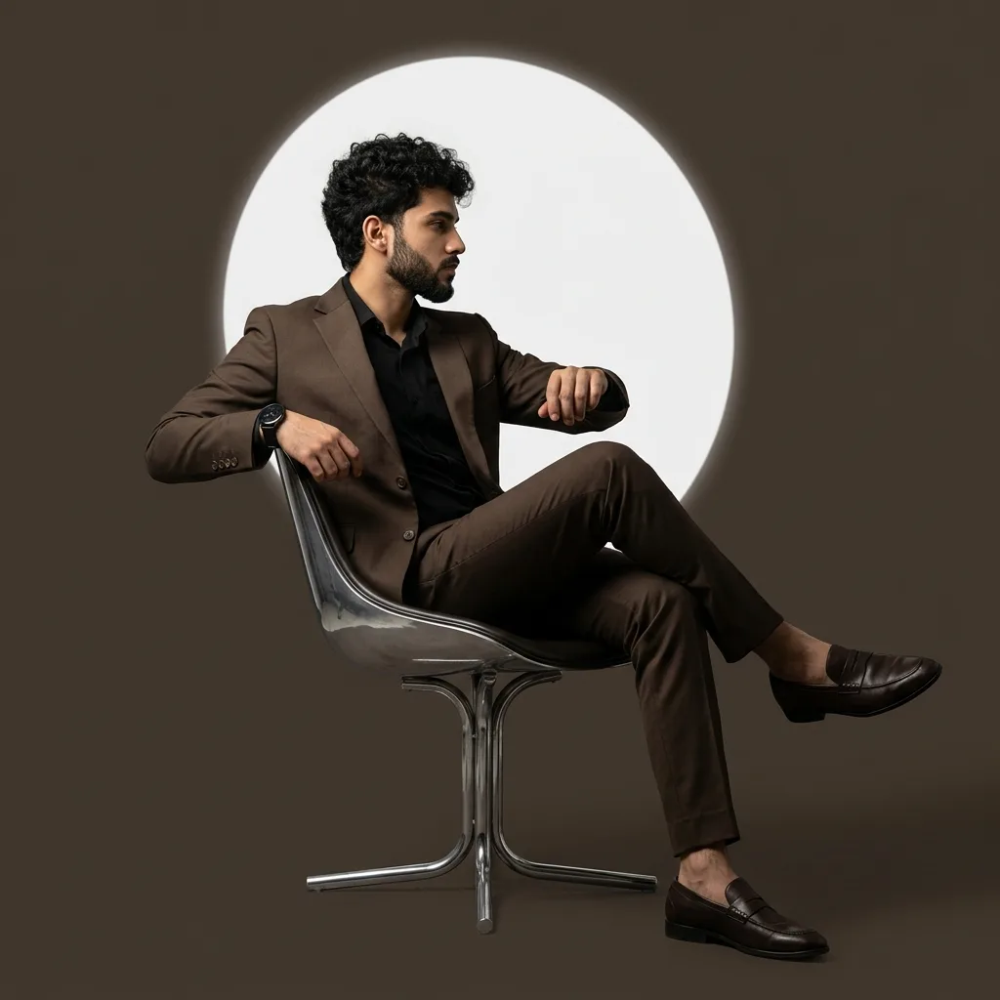

# Use The Uploaded Reference Photo As The Model

[← Back to the collection](../../README.md) · Category: [Photography](../../gallery/photography.md) · Model: `Vinano Image v2` · ID: `vn-00471`

<a href="https://vinano.ai?utm_source=github&utm_medium=readme&utm_campaign=awesome-image-video-prompts-updating&utm_content=prompt-page-image"></a>

<sub>Preview generated with <a href="https://vinano.ai?utm_source=github&utm_medium=readme&utm_campaign=awesome-image-video-prompts-updating&utm_content=prompt-page-caption">vinano.ai</a></sub>

## Prompt

```text
Use The Uploaded Reference Photo As The Model For The Face, Hairstyle, And Beard, Keeping Them Exactly As In The Reference. Render A Cinematic Studio Portrait Of A Young Man A Sporty Body Sitting Casually On A Futuristic, Minimalistic, Designer Chair, Legs Crossed. Outfit: Brown Suit (#483c32 Jacket And Pants), Black Shirt Under The Jacket, Dark Brown Loafers, Black Oneplus Watch 346mm On Left Wrist. Background: Solid #483c32 A Large White Circle Behind The Head, Filled And Slightly Glowing. Lighting: Bright Soft Studio Light, Producing Sharp Shadows And Moody Atmosphere. Pose: Relaxed, Slightly Leaning, One Hand On The Chair's Backrest, Face Turned To The Side. Ultra-detailed, Photo Realistic, Cinematic Contrast, Fabric Texture Emphasized. Ensure The Hairstyle, Beard, And Face Remain Exactly As In The Uploaded Reference Photo. Aim for an editorial, design-driven look with deliberate negative space.
```

## Try it on vinano.ai

1. Copy the prompt above.
2. Open **[vinano.ai](https://vinano.ai?utm_source=github&utm_medium=readme&utm_campaign=awesome-image-video-prompts-updating&utm_content=prompt-page-try)**, paste it into the image generator and pick a model.
3. Swap any placeholders (brand, product, city, person…) for your own details, then generate.

More prompts like this: [Photography gallery](../../gallery/photography.md) · [all categories](../../README.md#contents)
