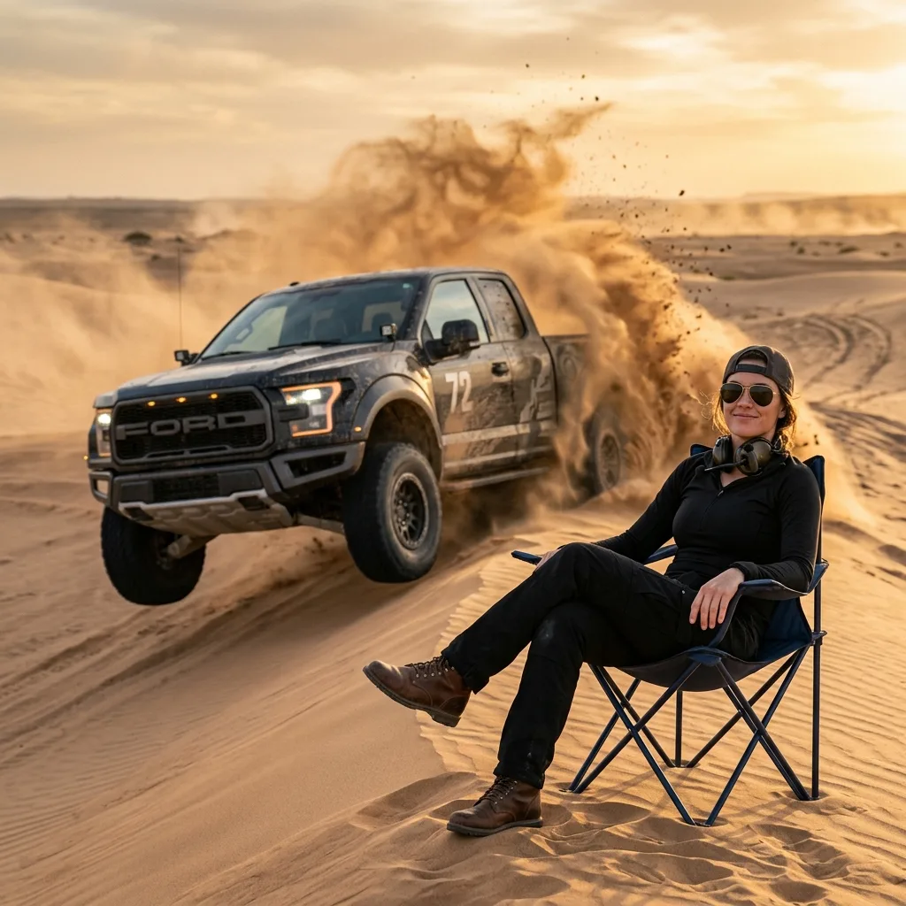

# Foreground, right side

[← Back to the collection](../../README.md) · Category: [Photography](../../gallery/photography.md) · Model: `Vinano Image Pro` · ID: `vn-00473`

<a href="https://vinano.ai?utm_source=github&utm_medium=readme&utm_campaign=awesome-image-video-prompts-updating&utm_content=prompt-page-image"></a>

<sub>Preview generated with <a href="https://vinano.ai?utm_source=github&utm_medium=readme&utm_campaign=awesome-image-video-prompts-updating&utm_content=prompt-page-caption">vinano.ai</a></sub>

## Prompt

```text
{
 "type": "image_generation_prompt",
 "language": "English",
 "aspect_ratio": "9:16",
 "style": "cinematic, ultra-realistic, high-speed action photography",
 "identity_preservation": {
 "use_reference_image": true,
 "strict_identity_lock": true,
 "notes": "Do not change face, hair, or facial features. Preserve the exact facial identity, hairstyle, proportions, and expression from the reference image."
 },
 "subject": {
 "gender": "female",
 "position_in_frame": "foreground, right side",
 "pose": {
 "seating": "sitting in a small folding camping chair on top of a sand dune",
 "legs": "crossed casually",
 "posture": "leaning back comfortably"
 },
 "expression": "confident, playful, relaxed a subtle smile",
 "appearance": {
 "outfit": {
 "clothing": "black outfit (top and pants)",
 "boots": "brown boots",
 "headwear": "dark baseball cap",
 "accessories": ["sunglasses",
 "headset microphone"]
 }
 }
 },
 "secondary_subject": {
 "vehicle": {
 "type": "powerful off-road pickup truck",
 "style_reference": "Ford Raptor–style",
 "action": "driving aggressively at full speed over the sand dune",
 "motion_state": "slightly airborne",
 "effects": ["dramatic explosion of sand and dust",
 "visible motion blur emphasizing speed"],
 "position_in_frame": "background, slightly left and centered"
 }
 },
 "environment": {
 "location": "desert sand dunes",
 "time_of_day": "golden hour",
 "atmosphere": "warm, cinematic, dramatic contrast between calm and chaos"
 },
 "lighting": {
 "type": "natural golden hour sunlight",
 "quality": "soft and warm",
 "effects": ["gentle highlights on flying sand particles",
 "soft shadows",
 "cinematic teal and orange color balance"]
 },
 "camera": {
 "angle": "low, cinematic angle",
 "lens": "telephoto ~85mm",
 "depth_of_field": "shallow",
 "focus": {
 "foreground": "woman in sharp focus",
 "background": "truck slightly motion-blurred"
 }
 },
 "color_grading": {
 "palette": ["warm beige sand",
 "muted sky tones",
 "subtle teal and orange accents"],
 "style": "filmic, natural, HDR"
 },
 "quality": {
 "resolution": "8K",
 "detail_level": "ultra-high",
 "texture": "realistic sand, fabric, skin, and dust textures",
 "grain": "subtle film grain",
 "rendering": "true-to-life photorealistic, no CGI look"
 },
 "constraints": ["No cartoon or illustrated style",
 "No artificial sharpening",
 "No exaggerated effects",
 "Maintain natural skin tones",
 "Do not alter facial identity"],
 "output_goal": "Create a cinematic, ultra-realistic desert action image featuring a calm, confident woman seated in the foreground while a powerful off-road truck explodes through the dunes behind her, emphasizing contrast, motion, and cinematic storytelling."
}

Render with rich micro-detail while keeping the layout uncluttered and intentional.
```

## Try it on vinano.ai

1. Copy the prompt above.
2. Open **[vinano.ai](https://vinano.ai?utm_source=github&utm_medium=readme&utm_campaign=awesome-image-video-prompts-updating&utm_content=prompt-page-try)**, paste it into the image generator and pick a model.
3. Swap any placeholders (brand, product, city, person…) for your own details, then generate.

More prompts like this: [Photography gallery](../../gallery/photography.md) · [all categories](../../README.md#contents)
