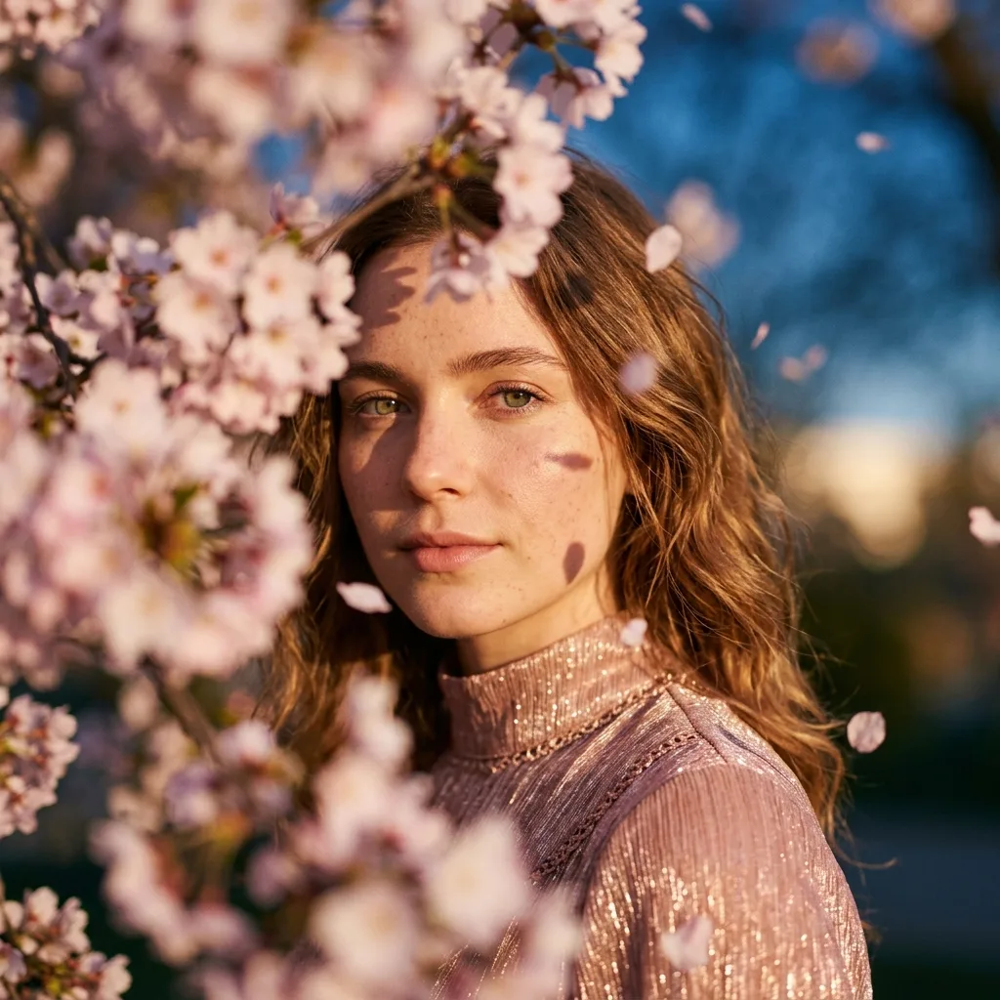

# Young woman, expressive green eyes, calm introspective expression, natural

[← Back to the collection](../../README.md) · Category: [Photography](../../gallery/photography.md) · Model: `Vinano Image v2` · ID: `vn-00479`

<a href="https://vinano.ai?utm_source=github&utm_medium=readme&utm_campaign=awesome-image-video-prompts-updating&utm_content=prompt-page-image"></a>

<sub>Preview generated with <a href="https://vinano.ai?utm_source=github&utm_medium=readme&utm_campaign=awesome-image-video-prompts-updating&utm_content=prompt-page-caption">vinano.ai</a></sub>

## Prompt

```text
{
 "image_prompt": {
 "main_description": "Poetic cinematic close-up portrait of a young woman partially obscured by soft pink blossoms and petals in the foreground.",
 "subject_details": {
 "appearance": "Young woman, expressive green eyes, calm introspective expression, natural beauty",
 "skin_texture": "Ultra-realistic skin texture",
 "apparel": "Shimmering rose-gold high-neck dress that catches warm sunlight"
 },
 "composition_and_framing": {
 "framing": "Close-up, face in sharp focus through gaps in the flowers",
 "foreground": "Soft pink blossoms and petals, soft blur",
 "background": "Deep blue sky, creamy bokeh",
 "depth": "Shallow depth of field"
 },
 "lighting_and_color": {
 "lighting_source": "Golden-hour lighting",
 "effects": "Delicate shadows of petals across skin, dress catching sunlight",
 "palette": "Pastel pinks, warm peach tones, rose-gold, deep blue"
 },
 "atmosphere_and_style": {
 "mood": "Romantic spring atmosphere, ethereal, poetic",
 "style": "Editorial fashion photography",
 "grading": "Cinematic color grading"
 },
 "technical_specs": {
 "quality": "8K resolution, high detail",
 "visuals": "Ultra-realistic"
 }
 }
}

Keep edges clean and the overall composition balanced for a polished, gallery-ready result.
```

## Try it on vinano.ai

1. Copy the prompt above.
2. Open **[vinano.ai](https://vinano.ai?utm_source=github&utm_medium=readme&utm_campaign=awesome-image-video-prompts-updating&utm_content=prompt-page-try)**, paste it into the image generator and pick a model.
3. Swap any placeholders (brand, product, city, person…) for your own details, then generate.

More prompts like this: [Photography gallery](../../gallery/photography.md) · [all categories](../../README.md#contents)
