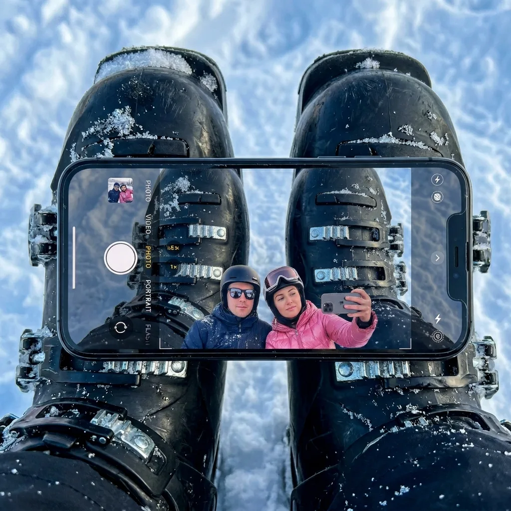

# Winter scene in a vertical 3:4 aspect ratio cinematic

[← Back to the collection](../../README.md) · Category: [Photography](../../gallery/photography.md) · Model: `Vinano Image v2` · ID: `vn-00483`

<a href="https://vinano.ai?utm_source=github&utm_medium=readme&utm_campaign=awesome-image-video-prompts-updating&utm_content=prompt-page-image"></a>

<sub>Preview generated with <a href="https://vinano.ai?utm_source=github&utm_medium=readme&utm_campaign=awesome-image-video-prompts-updating&utm_content=prompt-page-caption">vinano.ai</a></sub>

## Prompt

```text
Create a hyper-realistic winter scene in a vertical 3:4 aspect ratio cinematic realism and natural detail. The foreground features compacted snow subtle ice sparkle, cool blue shadows, and cold ambient light. A smartphone is placed perfectly horizontally across black ski boots, stable and centered, visible smudges, micro-reflections, edge highlights, and slight screen glare. The iPhone camera Ul is clearly visible, including icons and the shutter button, reinforcing an authentic, unedited iPhone capture. On the phone screen, Subject 1 and Subject 2 are seated closely together on the snow, framed from a low angle so only their upper bodies are visible, creating an intimate mirror-selfie-style composition. Subject 2 sits slightly forward, holding the phone at arm's length the phone back visible, wearing a glossy pink puffer jacket realistic quilting, natural folds, helmet, and goggles; her face is fully clear and visible a relaxed, confident expression. Subject 1 sits directly beside her, shoulders nearly touching, wearing a neutral ski jacket light snow dusting, a helmet, and dark sunglasses reflecting the snowy environment: his face is also fully clear and visible, a calm, relaxed posture. The background within the screen shows a snowy slope and distant ski-area elements softened by realistic depth and atmospheric haze. Lighting blends cool winter tones warm sunlight reflections, producing natural shadows, lifelike highlights, and subtle imperfections. The final image must feel HD, realistic, candid, and cinematic, both subjects facial features preserved exactly and remaining 1000% identical to the uploaded images. Render with rich micro-detail while keeping the layout uncluttered and intentional.
```

## Try it on vinano.ai

1. Copy the prompt above.
2. Open **[vinano.ai](https://vinano.ai?utm_source=github&utm_medium=readme&utm_campaign=awesome-image-video-prompts-updating&utm_content=prompt-page-try)**, paste it into the image generator and pick a model.
3. Swap any placeholders (brand, product, city, person…) for your own details, then generate.

More prompts like this: [Photography gallery](../../gallery/photography.md) · [all categories](../../README.md#contents)
