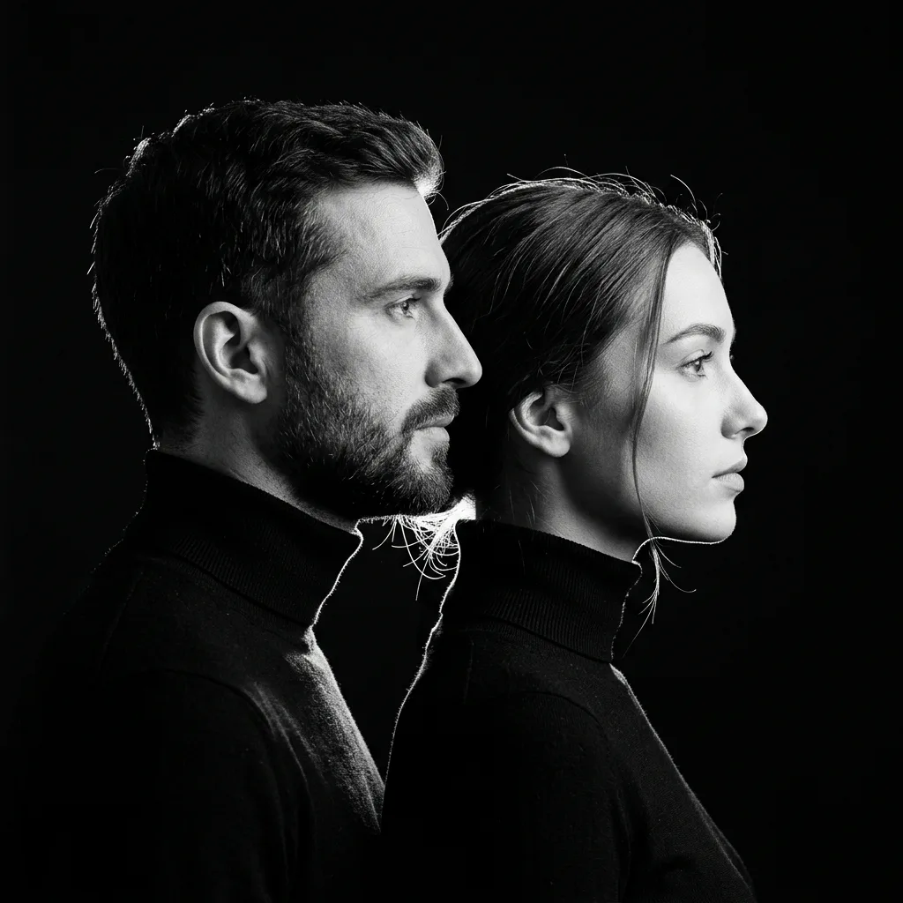

# Refined minimalist black and white cinematic portrait featuring two

[← Back to the collection](../../README.md) · Category: [Photography](../../gallery/photography.md) · Model: `Vinano Image v2` · ID: `vn-00484`

<a href="https://vinano.ai?utm_source=github&utm_medium=readme&utm_campaign=awesome-image-video-prompts-updating&utm_content=prompt-page-image"></a>

<sub>Preview generated with <a href="https://vinano.ai?utm_source=github&utm_medium=readme&utm_campaign=awesome-image-video-prompts-updating&utm_content=prompt-page-caption">vinano.ai</a></sub>

## Prompt

```text
A refined minimalist black and white cinematic portrait featuring two individuals (male and female) in strict side profile, both facing the same direction calm, introspective expressions, wearing elegant black turtlenecks. The scene is set against a pure black background dramatic rim lighting outlining their facial contours and hair strands. High contrast lighting creates deep shadows and soft highlights, emphasizing sharp facial structure and texture. Fine art editorial photography style, ultra-realistic, crisp composition, subtle film grain, 8K resolution. Keep edges clean and the overall composition balanced for a polished, gallery-ready result.
```

## Try it on vinano.ai

1. Copy the prompt above.
2. Open **[vinano.ai](https://vinano.ai?utm_source=github&utm_medium=readme&utm_campaign=awesome-image-video-prompts-updating&utm_content=prompt-page-try)**, paste it into the image generator and pick a model.
3. Swap any placeholders (brand, product, city, person…) for your own details, then generate.

More prompts like this: [Photography gallery](../../gallery/photography.md) · [all categories](../../README.md#contents)
