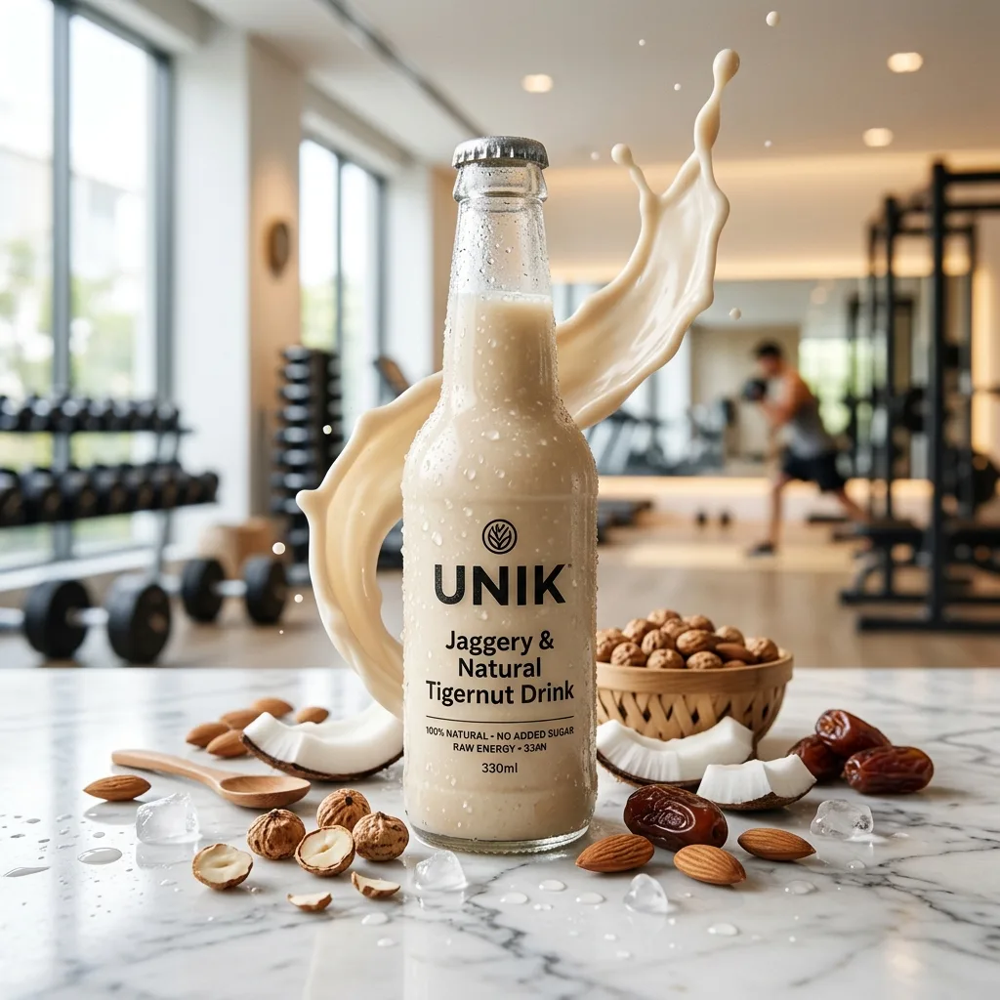

# Lifestyle beverage advertisement featuring a chilled bottle of “UNIK

[← Back to the collection](../../README.md) · Category: [Photography](../../gallery/photography.md) · Model: `Vinano Image v2` · ID: `vn-00486`

<a href="https://vinano.ai?utm_source=github&utm_medium=readme&utm_campaign=awesome-image-video-prompts-updating&utm_content=prompt-page-image"></a>

<sub>Preview generated with <a href="https://vinano.ai?utm_source=github&utm_medium=readme&utm_campaign=awesome-image-video-prompts-updating&utm_content=prompt-page-caption">vinano.ai</a></sub>

## Prompt

```text
Ultra-realistic lifestyle beverage advertisement featuring a chilled bottle of “UNIK – Jaggery & Natural Tigernut Drink.” The bottle stands on a clean marble or gym countertop surrounded by natural ingredients such as tigernuts, almonds, coconut slices, and dates. A smooth splash of creamy tigernut milk flows upward behind the bottle while ice cubes scatter around it. The bottle is covered condensation droplets indicating cold freshness. The background features a bright modern fitness studio soft natural lighting and blurred gym equipment. The composition communicates energy, health, and natural nutrition. High-end commercial beverage photography, macro details, shallow depth of field, ultra-realistic textures, true-to-life photorealistic lighting, clean advertising style, 8K resolution. Preserve realistic proportions and depth for a confident, professional finish.
```

## Try it on vinano.ai

1. Copy the prompt above.
2. Open **[vinano.ai](https://vinano.ai?utm_source=github&utm_medium=readme&utm_campaign=awesome-image-video-prompts-updating&utm_content=prompt-page-try)**, paste it into the image generator and pick a model.
3. Swap any placeholders (brand, product, city, person…) for your own details, then generate.

More prompts like this: [Photography gallery](../../gallery/photography.md) · [all categories](../../README.md#contents)
