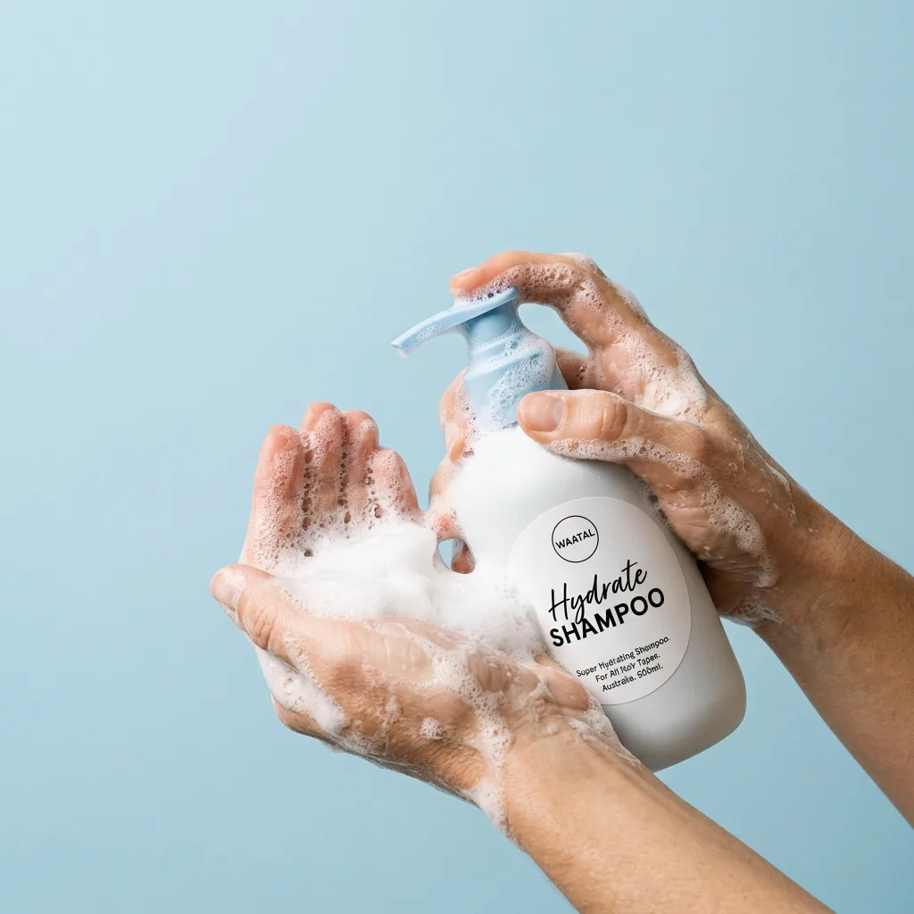

# Hands holding a shampoo bottle lather

[← Back to the collection](../../README.md) · Category: [Photography](../../gallery/photography.md) · Model: `Vinano Image v2` · ID: `vn-00496`

<a href="https://vinano.ai?utm_source=github&utm_medium=readme&utm_campaign=awesome-image-video-prompts-updating&utm_content=prompt-page-image"></a>

<sub>Preview generated with <a href="https://vinano.ai?utm_source=github&utm_medium=readme&utm_campaign=awesome-image-video-prompts-updating&utm_content=prompt-page-caption">vinano.ai</a></sub>

## Prompt

```text
The soft touch.

 on Gemini

Prompt

{
 "product_photography_prompt": {
 "subject": "Hands holding a shampoo bottle lather.",
 "hands": {
 "description": "A person's hands natural skin tone.",
 "action": "One hand holds the bottle, the other is cupped to catch foam.",
 "condition": "Covered in thick, white, bubbly soap lather."
 },
 "bottle": {
 "type": "Pump bottle.",
 "material": "Matte white plastic.",
 "dispenser": "Light blue pump.",
 "contents": "White shampoo, visible as foam."
 },
 "label": {
 "color": "White",
 "text_color": "Black",
 "logo": "Circular 'WAATAL' inside.",
 "main_text": "Hydrate SHAMPOO (script and bold font).",
 "sub_text": "Super Hydrating Shampoo. For All Hair Types. Australia. 500ml."
 },
 "foam": {
 "texture": "Thick, rich, bubbly lather.",
 "color": "White",
 "location": "Covering hands, bottle neck, and dispenser."
 },
 "background": {
 "color": "Solid soft light blue.",
 "texture": "Seamless, smooth studio background."
 },
 "lighting": {
 "type": "Soft, diffused studio lighting.",
 "direction": "Even illumination, highlighting foam texture and hands."
 },
 "style": {
 "type": "Clean, refined minimalist product photography.",
 "shot": "Close-up.",
 "focus": "Sharp focus on hands, bottle, and foam.",
 "mood": "Fresh, clean, natural."
 }
 }
}

Aim for an editorial, design-driven look with deliberate negative space.
```

## Try it on vinano.ai

1. Copy the prompt above.
2. Open **[vinano.ai](https://vinano.ai?utm_source=github&utm_medium=readme&utm_campaign=awesome-image-video-prompts-updating&utm_content=prompt-page-try)**, paste it into the image generator and pick a model.
3. Swap any placeholders (brand, product, city, person…) for your own details, then generate.

More prompts like this: [Photography gallery](../../gallery/photography.md) · [all categories](../../README.md#contents)
