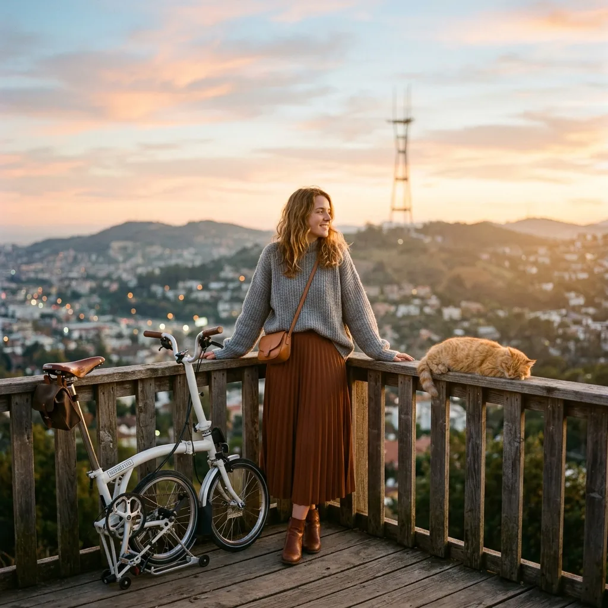

# Golden-hour photograph of a young woman standing

[← Back to the collection](../../README.md) · Category: [Photography](../../gallery/photography.md) · Model: `Vinano Image v2` · ID: `vn-00500`

<a href="https://vinano.ai?utm_source=github&utm_medium=readme&utm_campaign=awesome-image-video-prompts-updating&utm_content=prompt-page-image"></a>

<sub>Preview generated with <a href="https://vinano.ai?utm_source=github&utm_medium=readme&utm_campaign=awesome-image-video-prompts-updating&utm_content=prompt-page-caption">vinano.ai</a></sub>

## Prompt

```text
A cinematic golden-hour photograph of a young woman standing on a wooden viewpoint balcony overlooking a city, leaning casually against the railing. She wears an oversized grey knitted sweater, a long brown skirt, and brown ankle boots, a small leather crossbody bag. A white folding bicycle rests beside her, and an orange cat sleeps peacefully on the wooden railing next to her. In the background, soft-focus hills a tall communication tower rise above the city. Warm sunset light, pastel sky gentle clouds, shallow depth of field, calm and dreamy mood, realistic photography, high detail, natural colors, 35mm lens, soft bokeh. Preserve realistic proportions and depth for a confident, professional finish.
```

## Try it on vinano.ai

1. Copy the prompt above.
2. Open **[vinano.ai](https://vinano.ai?utm_source=github&utm_medium=readme&utm_campaign=awesome-image-video-prompts-updating&utm_content=prompt-page-try)**, paste it into the image generator and pick a model.
3. Swap any placeholders (brand, product, city, person…) for your own details, then generate.

More prompts like this: [Photography gallery](../../gallery/photography.md) · [all categories](../../README.md#contents)
