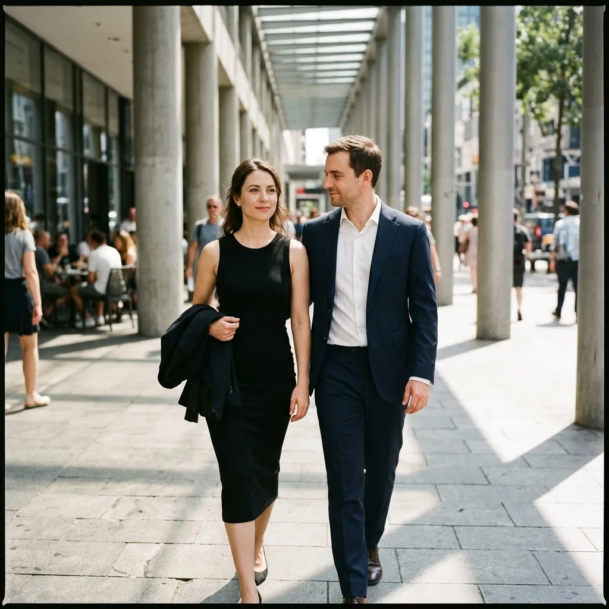

# Candid medium shot portrait of a man

[← Back to the collection](../../README.md) · Category: [Photography](../../gallery/photography.md) · Model: `Vinano Image v2` · ID: `vn-00502`

<a href="https://vinano.ai?utm_source=github&utm_medium=readme&utm_campaign=awesome-image-video-prompts-updating&utm_content=prompt-page-image"></a>

<sub>Preview generated with <a href="https://vinano.ai?utm_source=github&utm_medium=readme&utm_campaign=awesome-image-video-prompts-updating&utm_content=prompt-page-caption">vinano.ai</a></sub>

## Prompt

```text
A cinematic candid medium shot portrait of a man and a woman walking side by side along a bright urban walkway, framed from the waist up. They move closely together, their shoulders nearly aligned, creating an intimate yet understated connection. The woman wears a fitted black dress, holding a jacket loosely over her arm, her posture relaxed and elegant. The man walks beside her in a tailored suit, his head slightly turned toward her a soft, attentive expression, while she looks ahead a calm and composed demeanor, a faint hint of a smile forming. The moment feels natural and unspoken, filled quiet tension and subtle attraction. Strong midday sunlight casts sharp highlights and deep shadows across their faces and clothing, creating a high-contrast, slightly overexposed look. The background features a softly blurred urban corridor repeating columns and architectural lines. The image has a strong analog film aesthetic visible grain, slight blur, color distortion, and nostalgic texture. Colors feel slightly faded warm, muted tones. Imperfect framing, subtle motion softness, and natural light flare create the feeling of a fleeting moment captured on 35mm film. Cinematic film still, dreamy and poetic mood, intimate and quiet romantic energy, vintage street photography, lo-fi aesthetic, high detail, hd quality. Maintain consistent colour harmony and crisp focus across the whole frame.
```

## Try it on vinano.ai

1. Copy the prompt above.
2. Open **[vinano.ai](https://vinano.ai?utm_source=github&utm_medium=readme&utm_campaign=awesome-image-video-prompts-updating&utm_content=prompt-page-try)**, paste it into the image generator and pick a model.
3. Swap any placeholders (brand, product, city, person…) for your own details, then generate.

More prompts like this: [Photography gallery](../../gallery/photography.md) · [all categories](../../README.md#contents)
