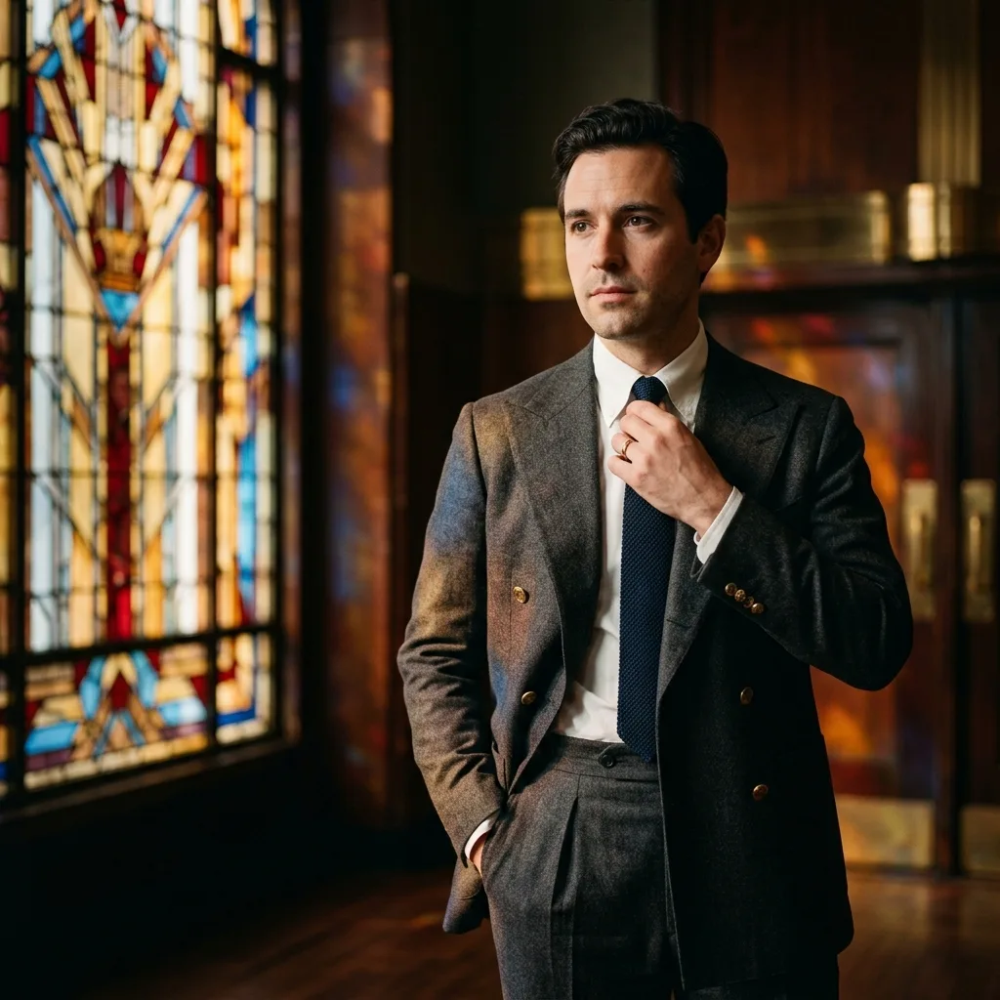

# Captured in 16-bit RAW high dynamic range and soft

[← Back to the collection](../../README.md) · Category: [Photography](../../gallery/photography.md) · Model: `Vinano Image v2` · ID: `vn-00505`

<a href="https://vinano.ai?utm_source=github&utm_medium=readme&utm_campaign=awesome-image-video-prompts-updating&utm_content=prompt-page-image"></a>

<sub>Preview generated with <a href="https://vinano.ai?utm_source=github&utm_medium=readme&utm_campaign=awesome-image-video-prompts-updating&utm_content=prompt-page-caption">vinano.ai</a></sub>

## Prompt

```text
Shot on a Hasselblad 907X 50C an XCD 90mm f/2.5 lens, aperture f/2.8 shallow depth of field emphasizes the precision fit of the suit while the background dissolves into painterly color patches; captured in 16-bit RAW high dynamic range and soft film grain to preserve wool texture and the glow of colored light without "harsh" digital sharpness. Frame a tight portrait cropped to mid-chest, at eye level, a slight three-quarter turn; the model is offset from center so the stained-glass pattern reads in the negative space. The pose is calm and composed: shoulders open, posture confident but without tension; one hand neatly adjusts the tie knot or collar line, the other is in the trouser pocket, slightly opening the jacket and revealing the layered styling. Expression restrained and thoughtful; the gaze passes just past the lens, as if distant music is playing. Outfit a man in a suit a retro accent: a structured double-breasted wool blazer sharp lapels, high-waisted pleated trousers, a white shirt and narrow tie, polished Oxfords, and a minimal pocket square. Location a retro Art Deco hall dark wood, brass, and a tall stained-glass window projecting jewel-like geometry onto the suit and background. Light warm practical fill from one side and colored stained-glass light from the other, cinematic contrast, "stained-glass" shadows. Result -retro editorial: graphic, refined, expensive, and timeless Render with rich micro-detail while keeping the layout uncluttered and intentional.
```

## Try it on vinano.ai

1. Copy the prompt above.
2. Open **[vinano.ai](https://vinano.ai?utm_source=github&utm_medium=readme&utm_campaign=awesome-image-video-prompts-updating&utm_content=prompt-page-try)**, paste it into the image generator and pick a model.
3. Swap any placeholders (brand, product, city, person…) for your own details, then generate.

More prompts like this: [Photography gallery](../../gallery/photography.md) · [all categories](../../README.md#contents)
