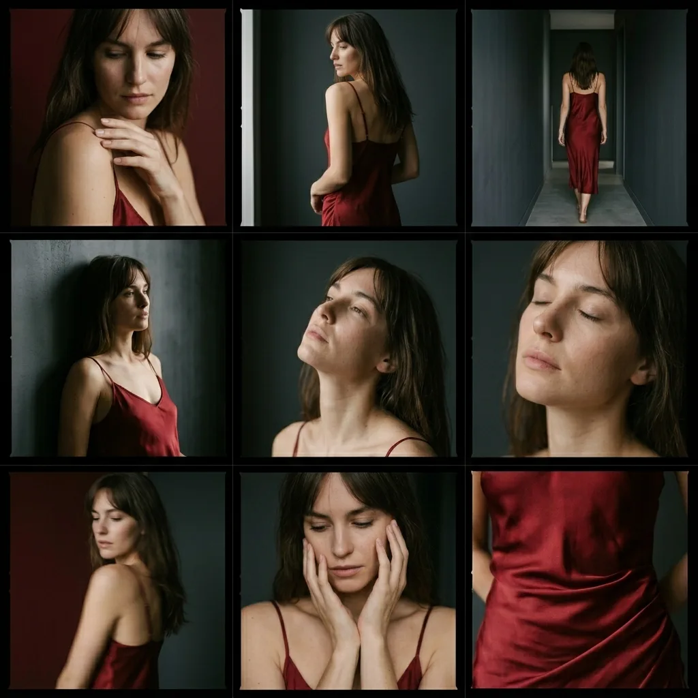

# 3x3 fashion contact sheet capturing an intimate, emotional editorial

[← Back to the collection](../../README.md) · Category: [Photography](../../gallery/photography.md) · Model: `Vinano Image Pro` · ID: `vn-00512`

<a href="https://vinano.ai?utm_source=github&utm_medium=readme&utm_campaign=awesome-image-video-prompts-updating&utm_content=prompt-page-image"></a>

<sub>Preview generated with <a href="https://vinano.ai?utm_source=github&utm_medium=readme&utm_campaign=awesome-image-video-prompts-updating&utm_content=prompt-page-caption">vinano.ai</a></sub>

## Prompt

```text
{
 "generation_request": {
 "meta_data": {
 "tool": "",
 "task_type": "photoreal_cinematic_fashion_contact_sheet",
 "version": "v1.0_RED_DRESS_INTIMATE_EDITORIAL_3x3_NO_TEXT",
 "priority": "highest"
 },

 "references": {
 "reference_image_1": {
 "source": "UPLOAD_REFERENCE_IMAGE (OPTIONAL)",
 "purpose": "FACE_IDENTITY_LOCK",
 "strict_lock": true,
 "face_similarity_priority": "MAX",
 "no_identity_blending": true,
 "no_beautify": true,
 "preserve_skin_texture": true,
 "preserve_facial_proportions": true
 }
 },

 "output_settings": {
 "aspect_ratio": "1:1",
 "resolution_target": "ultra_high_res",
 "render_style": "cinematic_fashion_editorial",
 "sharpness": "soft_cinematic_focus",
 "film_grain": "subtle_analog_35mm",
 "dynamic_range": "natural_not_hdr",
 "color_grade": "muted_warm_reds_dark_neutrals",
 "skin_rendering": "real_skin_microtexture_no_plastic"
 },

 "layout": {
 "type": "contact_sheet",
 "grid": "3x3",
 "spacing": "thin_clean_dividers",
 "panel_consistency": "same_subject_same_outfit_same_scene",
 "no_text_overlay": true
 },

 "camera": {
 "camera_type": "full_frame_cinema_camera",
 "lens": "50mm_and_85mm_mix",
 "aperture": "f1.8",
 "depth_of_field": "shallow",
 "focus_behavior": "eyes_priority_some_frames_soft_motion",
 "processing": "no_ai_sharpening_no_hdr"
 },

 "lighting": {
 "type": "low_key_cinematic_indoor_light",
 "source": "window_light_side_falloff",
 "contrast": "medium_to_low",
 "shadows": "soft_deep",
 "highlights": "controlled_skin_specular"
 },

 "wardrobe_and_styling": {
 "dress": "deep_red_silk_satin_slip_dress",
 "fabric_behavior": "fluid_realistic_drape_soft_specular",
 "straps": "thin_delicate",
 "overall_style": "intimate_high_fashion_editorial"
 },

 "hair_and_makeup": {
 "hair": "natural_loose_with_soft_bangs",
 "movement": "subtle_natural_motion",
 "makeup_style": "soft_editorial",
 "eyes": "natural_smoky_low_contrast",
 "lips": "muted_rose_nude",
 "skin_finish": "natural_luminous_real"
 },

 "posing_and_storytelling": {
 "poses": ["close_up_shoulder_touch",
 "mid_body_turning_away",
 "full_body_walking_away",
 "leaning_against_wall",
 "head_tilted_back_emotional",
 "eyes_closed_intimate",
 "soft_motion_blur_moment",
 "hands_touching_face",
 "dress_detail_closeup"],
 "emotion": "introspective_sensual_vulnerable",
 "movement": "slow_natural_unposed"
 },

 "background": {
 "environment": "dark_interior_gallery_or_room",
 "colors": ["deep_red",
 "charcoal_gray",
 "dark_green"],
 "texture": "matte_walls_soft_reflections",
 "distractions": "none"
 },

 "creative_prompt": {
 "scene_summary": "A cinematic 3x3 fashion contact sheet capturing an intimate, emotional editorial story of a woman in a deep red satin dress. Each frame feels like a quiet moment from an arthouse film — soft focus, natural movement, emotional restraint, and sensual minimalism.",
 "aesthetic": "arthouse_fashion_editorial",
 "mood": "quiet_intimate_cinematic"
 },

 "negative_prompt": ["text",
 "typography",
 "logo",
 "brand_name",
 "watermark",
 "poster_design",
 "magazine_layout",
 "beauty_filter",
 "plastic_skin",
 "over_smoothing",
 "cgi",
 "anime",
 "cartoon",
 "ai_artifacts",
 "extra_people",
 "distorted_body",
 "bad_hands",
 "extra_fingers",
 "over_sharpened"]
 }
}

Emphasise material texture and natural light so the final frame feels tactile and premium.
```

## Try it on vinano.ai

1. Copy the prompt above.
2. Open **[vinano.ai](https://vinano.ai?utm_source=github&utm_medium=readme&utm_campaign=awesome-image-video-prompts-updating&utm_content=prompt-page-try)**, paste it into the image generator and pick a model.
3. Swap any placeholders (brand, product, city, person…) for your own details, then generate.

More prompts like this: [Photography gallery](../../gallery/photography.md) · [all categories](../../README.md#contents)
