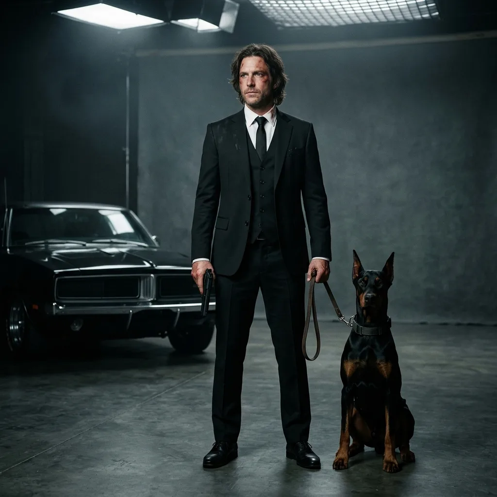

# Full body cinematic shot of the person

[← Back to the collection](../../README.md) · Category: [Photography](../../gallery/photography.md) · Model: `Vinano Image v2` · ID: `vn-00517`

<a href="https://vinano.ai?utm_source=github&utm_medium=readme&utm_campaign=awesome-image-video-prompts-updating&utm_content=prompt-page-image"></a>

<sub>Preview generated with <a href="https://vinano.ai?utm_source=github&utm_medium=readme&utm_campaign=awesome-image-video-prompts-updating&utm_content=prompt-page-caption">vinano.ai</a></sub>

## Prompt

```text
Full body cinematic shot of the person in the uploaded image as a hitman in a tailored black suit and tie standing in an empty studio space beside a muscular Doberman dog on a leash. The man has a bruised face blood marks, messy shoulder-length hair, and a calm but intense expression. He is holding a pistol in one hand. Behind them is a vintage black muscle car chrome rims partially visible in soft shadow. refined minimalist grey background, dramatic studio lighting from above creating soft reflections on the glossy floor. Ultra realistic skin texture, cinematic depth of field, sharp focus, subtle fog in the background, moody atmosphere, 85mm lens look, volumetric light, film still from a neo-noir action movie, high dynamic range, true-to-life photorealistic, 8k, symmetrical composition. 3:4 aspect ratio. Maintain consistent colour harmony and crisp focus across the whole frame.
```

## Try it on vinano.ai

1. Copy the prompt above.
2. Open **[vinano.ai](https://vinano.ai?utm_source=github&utm_medium=readme&utm_campaign=awesome-image-video-prompts-updating&utm_content=prompt-page-try)**, paste it into the image generator and pick a model.
3. Swap any placeholders (brand, product, city, person…) for your own details, then generate.

More prompts like this: [Photography gallery](../../gallery/photography.md) · [all categories](../../README.md#contents)
