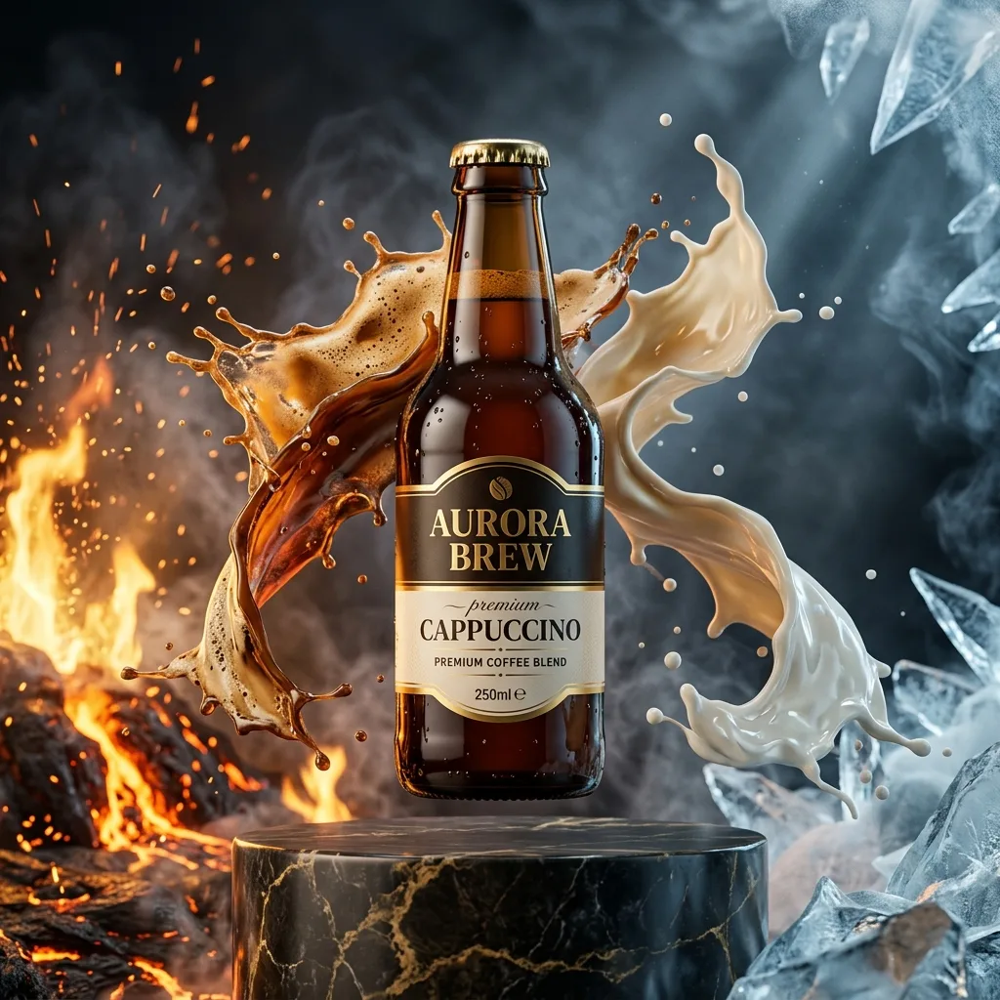

# 2 on Prompt

[← Back to the collection](../../README.md) · Category: [Photography](../../gallery/photography.md) · Model: `Vinano Image v2` · ID: `vn-00520`

<a href="https://vinano.ai?utm_source=github&utm_medium=readme&utm_campaign=awesome-image-video-prompts-updating&utm_content=prompt-page-image"></a>

<sub>Preview generated with <a href="https://vinano.ai?utm_source=github&utm_medium=readme&utm_campaign=awesome-image-video-prompts-updating&utm_content=prompt-page-caption">vinano.ai</a></sub>

## Prompt

```text
2 on

Prompt:
Ultra-realistic premium product advertisement of a cappuccino coffee bottle, centered composition, surrounded by dynamic liquid splashes of coffee and milk forming elegant swirling shapes in mid-air. Dramatic environments blending elements of fire, lava, ice shards, marble textures, and dark studio backgrounds.
Hyper-detailed liquid physics, droplets frozen in motion, filmic, cinematic lighting high contrast, glowing highlights, and volumetric light. Coffee splashes mixed creamy textures, energetic explosion effects, sparks, smoke, and mist.
Luxury branding style, glossy reflections on bottle, sharp label details, rich brown and gold color palette, macro photography, shallow depth of field, 85mm lens, commercial advertising style, studio + fantasy hybrid scene, ultra-detailed, 8K resolution.

Preserve realistic proportions and depth for a confident, professional finish.
```

## Try it on vinano.ai

1. Copy the prompt above.
2. Open **[vinano.ai](https://vinano.ai?utm_source=github&utm_medium=readme&utm_campaign=awesome-image-video-prompts-updating&utm_content=prompt-page-try)**, paste it into the image generator and pick a model.
3. Swap any placeholders (brand, product, city, person…) for your own details, then generate.

More prompts like this: [Photography gallery](../../gallery/photography.md) · [all categories](../../README.md#contents)
