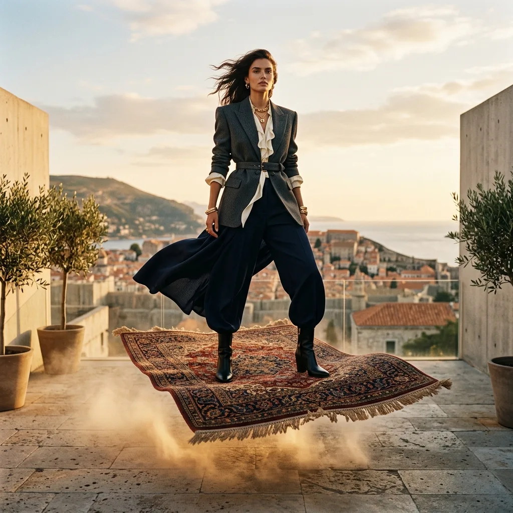

# High-fashion editorial shot of a GENDER model sitting or

[← Back to the collection](../../README.md) · Category: [Photography](../../gallery/photography.md) · Model: `Vinano Image v2` · ID: `vn-00523`

<a href="https://vinano.ai?utm_source=github&utm_medium=readme&utm_campaign=awesome-image-video-prompts-updating&utm_content=prompt-page-image"></a>

<sub>Preview generated with <a href="https://vinano.ai?utm_source=github&utm_medium=readme&utm_campaign=awesome-image-video-prompts-updating&utm_content=prompt-page-caption">vinano.ai</a></sub>

## Prompt

```text
{
 "options": {
 "gender": ["man", "woman"]
 },
 "prompt": "A high-fashion editorial shot of a [GENDER] model sitting or standing on a flying magic carpet during takeoff. The model is wearing a sophisticated, layered outfit featuring the structured silhouettes and premium textures typical of luxury brands like Celine, Balenciaga, Ralph Lauren, Givenchy, and Zegna. The clothes billow elegantly in the wind. The carpet is ornate and detailed, kicking up a subtle dust cloud as it ascends from a sun-drenched, refined minimalist architectural terrace. The lighting is cinematic and warm, highlighting the motion and the luxurious fabrics. Low angle perspective focusing entirely on the subject and the scene."
}

Maintain consistent colour harmony and crisp focus across the whole frame.
```

## Try it on vinano.ai

1. Copy the prompt above.
2. Open **[vinano.ai](https://vinano.ai?utm_source=github&utm_medium=readme&utm_campaign=awesome-image-video-prompts-updating&utm_content=prompt-page-try)**, paste it into the image generator and pick a model.
3. Swap any placeholders (brand, product, city, person…) for your own details, then generate.

More prompts like this: [Photography gallery](../../gallery/photography.md) · [all categories](../../README.md#contents)
