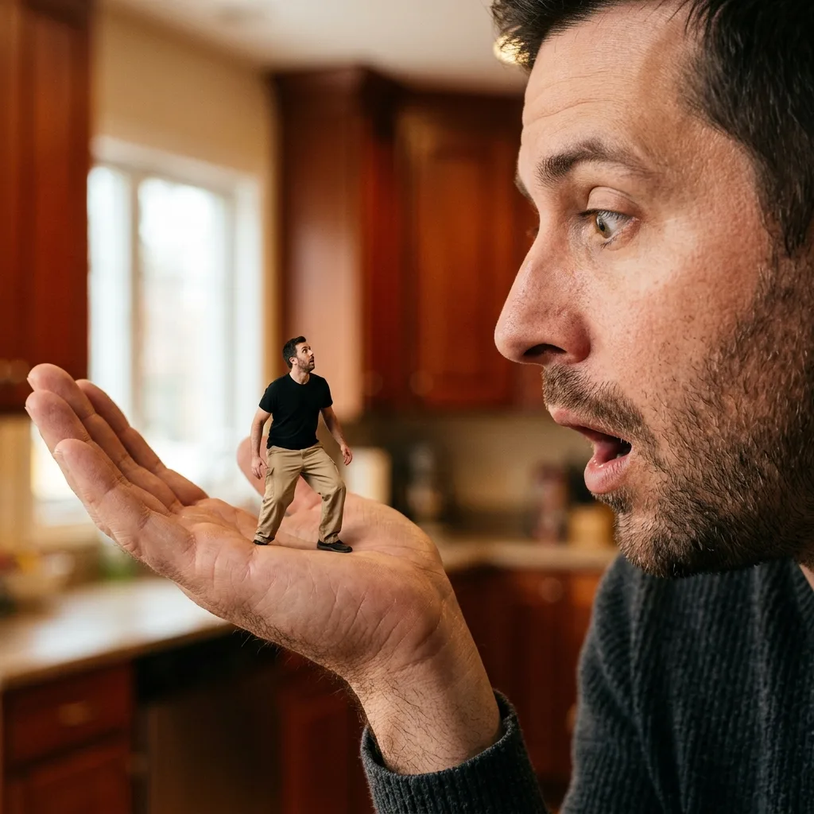

# Surreal composite shot utilizing forced perspective to create

[← Back to the collection](../../README.md) · Category: [Photography](../../gallery/photography.md) · Model: `Vinano Image v2` · ID: `vn-00527`

<a href="https://vinano.ai?utm_source=github&utm_medium=readme&utm_campaign=awesome-image-video-prompts-updating&utm_content=prompt-page-image"></a>

<sub>Preview generated with <a href="https://vinano.ai?utm_source=github&utm_medium=readme&utm_campaign=awesome-image-video-prompts-updating&utm_content=prompt-page-caption">vinano.ai</a></sub>

## Prompt

```text
A hyper-realistic, surreal composite shot utilizing forced perspective to create a dramatic scale difference, featuring an extreme close-up profile view on the right side of a man uploaded face as reference, his expression one of slack-jawed astonishment mouth slightly agape as he gazes downward. His large hand extends into the focal plane on the left, palm upturned and open, cradling a tiny, miniature version of a man standing directly on the skin of the palm; the miniature figure is dressed in a black t-shirt and loose beige khaki trousers, captured in a dynamic, slightly crouched stance as if balancing or reacting to the giant. The cinematography employs a shallow depth of field an 85mm portrait lens, keeping the giant's profile and the miniature figure in sharp focus while rendering the background—a warm-toned domestic interior reddish-brown wooden cabinetry and vague blue shapes—into a creamy, soft bokeh. The lighting is warm and naturalistic, suggestive of indoor tungsten sources, highlighting the skin texture, facial hair, and subsurface scattering on the giant's face, rendered in 8k resolution the fidelity of an Octane Render, emphasizing the absurdity and realism of the "shrunk" subject matter.

Man should be fully visible

Preserve realistic proportions and depth for a confident, professional finish.
```

## Try it on vinano.ai

1. Copy the prompt above.
2. Open **[vinano.ai](https://vinano.ai?utm_source=github&utm_medium=readme&utm_campaign=awesome-image-video-prompts-updating&utm_content=prompt-page-try)**, paste it into the image generator and pick a model.
3. Swap any placeholders (brand, product, city, person…) for your own details, then generate.

More prompts like this: [Photography gallery](../../gallery/photography.md) · [all categories](../../README.md#contents)
