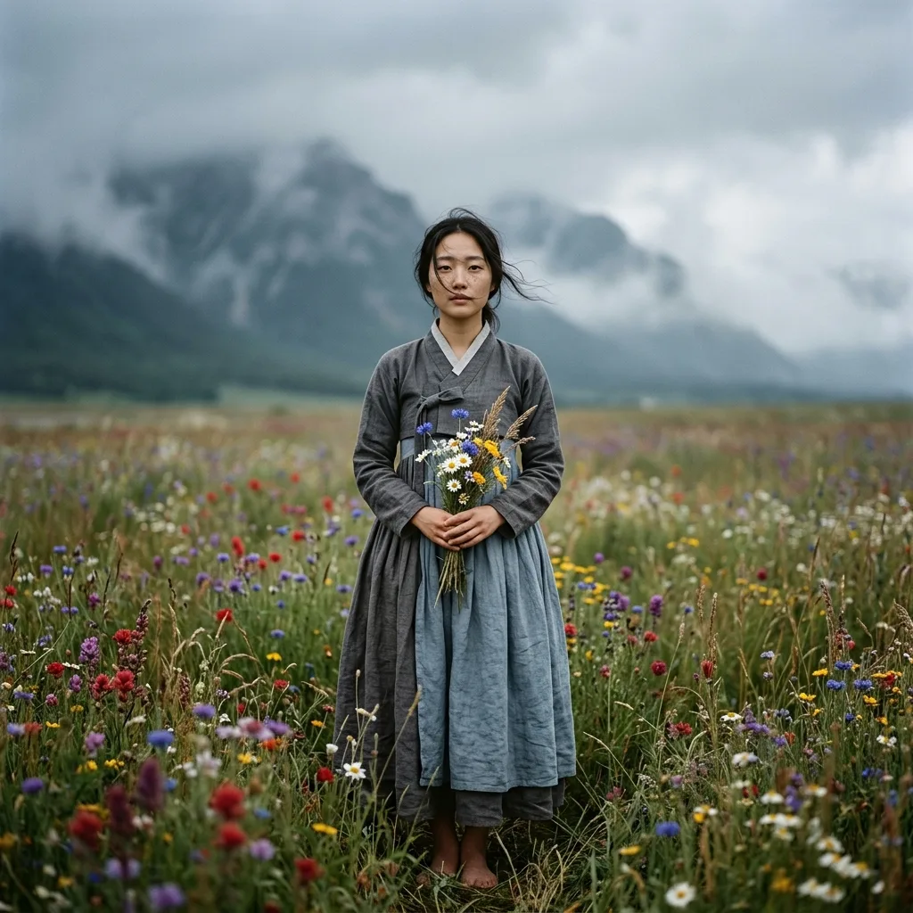

# Portrait of a young East Asian woman standing alone

[← Back to the collection](../../README.md) · Category: [Photography](../../gallery/photography.md) · Model: `Vinano Image v2` · ID: `vn-00530`

<a href="https://vinano.ai?utm_source=github&utm_medium=readme&utm_campaign=awesome-image-video-prompts-updating&utm_content=prompt-page-image"></a>

<sub>Preview generated with <a href="https://vinano.ai?utm_source=github&utm_medium=readme&utm_campaign=awesome-image-video-prompts-updating&utm_content=prompt-page-caption">vinano.ai</a></sub>

## Prompt

```text
Ultra-realistic cinematic portrait of a young East Asian woman standing alone in a vast wildflower meadow. She is centered in the frame, facing the camera directly a calm, introspective expression. She wears a traditional Korean hanbok in muted charcoal gray and soft blue tones, natural fabric texture and subtle folds. Her dark hair is loosely tied back a few strands gently blown across her face by the wind.

She holds a small hand-picked bouquet of wildflowers—white daisies, blue cornflowers, and dry grass stems—clasped softly in both hands at waist level. The meadow is filled colorful wildflowers (reds, whites, blues, purples) stretching into the distance.

In the background, a large mist-covered mountain rises softly out of focus, partially obscured by low clouds and fog, creating a moody, atmospheric depth. Overcast sky soft diffused natural light, cool color palette, muted contrast, cinematic realism.

Shallow depth of field, sharp focus on subject, creamy background bokeh. Natural skin texture, realistic facial details, no makeup look. Fine art photography style, emotional, poetic, timeless. Shot on a full-frame camera, 85mm lens, f/1.8, ultra-high resolution, true-to-life photorealistic, no text, no watermark.

Aim for an editorial, design-driven look with deliberate negative space.
```

## Try it on vinano.ai

1. Copy the prompt above.
2. Open **[vinano.ai](https://vinano.ai?utm_source=github&utm_medium=readme&utm_campaign=awesome-image-video-prompts-updating&utm_content=prompt-page-try)**, paste it into the image generator and pick a model.
3. Swap any placeholders (brand, product, city, person…) for your own details, then generate.

More prompts like this: [Photography gallery](../../gallery/photography.md) · [all categories](../../README.md#contents)
