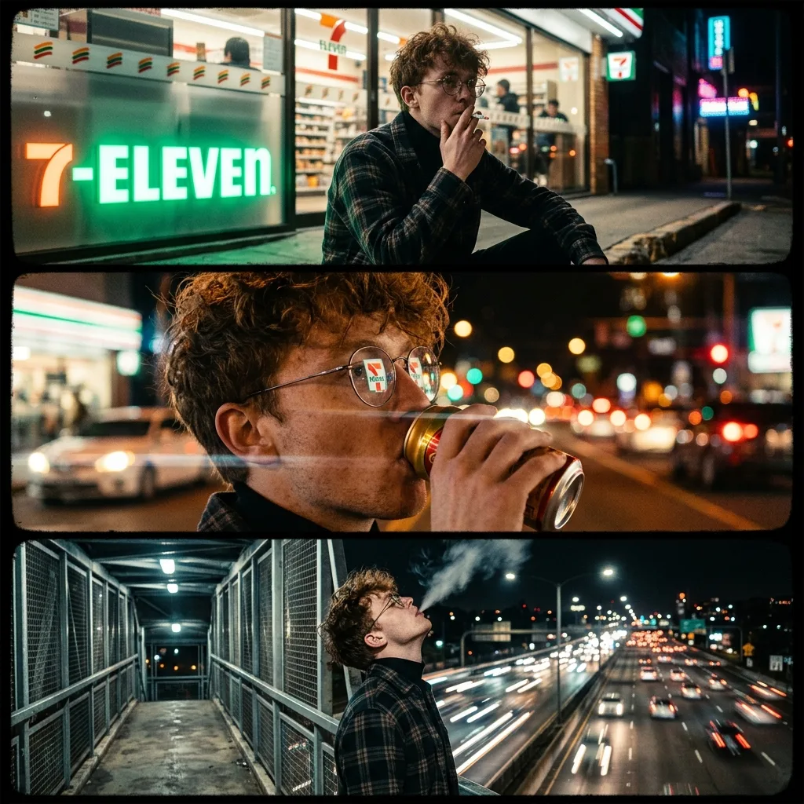

# Vertical triptych of three cinematic, night-time urban photographs featuring

[← Back to the collection](../../README.md) · Category: [Photography](../../gallery/photography.md) · Model: `Vinano Image Pro` · ID: `vn-00532`

<a href="https://vinano.ai?utm_source=github&utm_medium=readme&utm_campaign=awesome-image-video-prompts-updating&utm_content=prompt-page-image"></a>

<sub>Preview generated with <a href="https://vinano.ai?utm_source=github&utm_medium=readme&utm_campaign=awesome-image-video-prompts-updating&utm_content=prompt-page-caption">vinano.ai</a></sub>

## Prompt

```text
A vertical triptych of three cinematic, night-time urban photographs featuring a young man messy, curly reddish-brown hair and thin, round wire-frame glasses.
Top Panel: The man is seated in front of a 7-Eleven storefront. He wears a dark plaid flannel shirt over a black turtleneck. He is captured in a candid moment, holding a lit cigarette to his lips. To the left, there's a vibrant green neon sign. The lighting is dominated by a cool, fluorescent green glow and the warm interior light of the convenience store.
Middle Panel: An extreme close-up profile shot. He is drinking from a gold-and-red metallic beverage can. His glasses catch a sharp, vivid reflection of the 7-Eleven logo and orange-red street lights. A subtle lens flare streaks horizontally across his face. The background is a soft, warm bokeh of city lights and traffic signals.
Bottom Panel: The man stands on a pedestrian overpass overlooking a busy highway. He has his head tilted back, exhaling a thick wisp of white smoke into the night air. Below him, the blurred streaks of white headlights and red taillights create a sense of motion. The overpass structure is lit cool-toned industrial lamps, contrasting his warm skin tones.
Style: 35mm film aesthetic, cinematic grain, shallow depth of field, high contrast, urban noir mood.

Preserve realistic proportions and depth for a confident, professional finish.
```

## Try it on vinano.ai

1. Copy the prompt above.
2. Open **[vinano.ai](https://vinano.ai?utm_source=github&utm_medium=readme&utm_campaign=awesome-image-video-prompts-updating&utm_content=prompt-page-try)**, paste it into the image generator and pick a model.
3. Swap any placeholders (brand, product, city, person…) for your own details, then generate.

More prompts like this: [Photography gallery](../../gallery/photography.md) · [all categories](../../README.md#contents)
