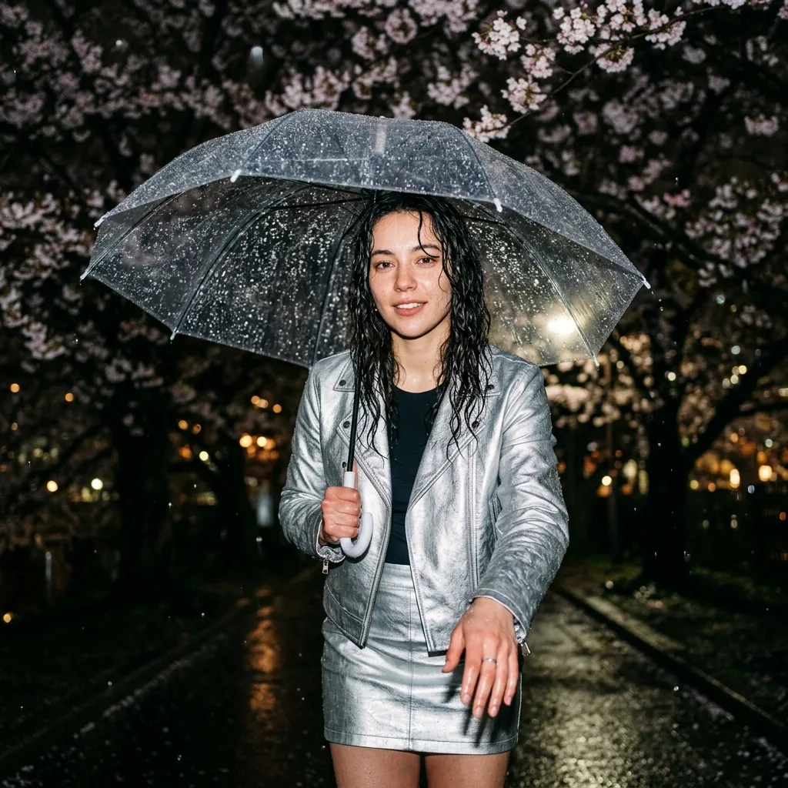

# High-resolution nighttime editorial portrait shot on-camera flash

[← Back to the collection](../../README.md) · Category: [Photography](../../gallery/photography.md) · Model: `Vinano Image v2` · ID: `vn-00533`

<a href="https://vinano.ai?utm_source=github&utm_medium=readme&utm_campaign=awesome-image-video-prompts-updating&utm_content=prompt-page-image"></a>

<sub>Preview generated with <a href="https://vinano.ai?utm_source=github&utm_medium=readme&utm_campaign=awesome-image-video-prompts-updating&utm_content=prompt-page-caption">vinano.ai</a></sub>

## Prompt

```text
{
 "prompt": "High-resolution nighttime editorial portrait shot on-camera flash. A young woman standing outdoors at night under blooming cherry blossom trees, holding a transparent clear umbrella covered in raindrops. Her hair is wet and slightly wavy, framing her face naturally. She wears a brown leather jacket a matching skirt, styled minimal and modern. One hand reaches slightly toward the camera, creating depth and intimacy. Strong flash lighting a dark background, rain droplets frozen in motion, cinematic contrast, shallow depth of field, fashion editorial vibe, realistic skin tones, sharp focus. No text, no watermark.",
 "style": "fashion editorial, cinematic, modern",
 "camera": {
 "shot_type": "portrait",
 "lighting": "on-camera flash",
 "depth_of_field": "shallow"
 },
 "lighting": {
 "type": "strong flash",
 "environment": "nighttime",
 "effect": ["high contrast", "frozen raindrops"]
 },
 "environment": {
 "location": "outdoor nighttime setting",
 "elements": ["cherry blossom trees", "rain", "dark background"]
 },
 "wardrobe": {
 "outfit": ["Silver leather jacket", "matching skirt"],
 "style": "minimal, modern"
 },
 "mood": ["intimate", "cinematic", "editorial"],
 "quality": ["high-resolution", "sharp focus", "realistic skin tones"],
 "constraints": ["no text", "no watermark"]
}

Emphasise material texture and natural light so the final frame feels tactile and premium.
```

## Try it on vinano.ai

1. Copy the prompt above.
2. Open **[vinano.ai](https://vinano.ai?utm_source=github&utm_medium=readme&utm_campaign=awesome-image-video-prompts-updating&utm_content=prompt-page-try)**, paste it into the image generator and pick a model.
3. Swap any placeholders (brand, product, city, person…) for your own details, then generate.

More prompts like this: [Photography gallery](../../gallery/photography.md) · [all categories](../../README.md#contents)
