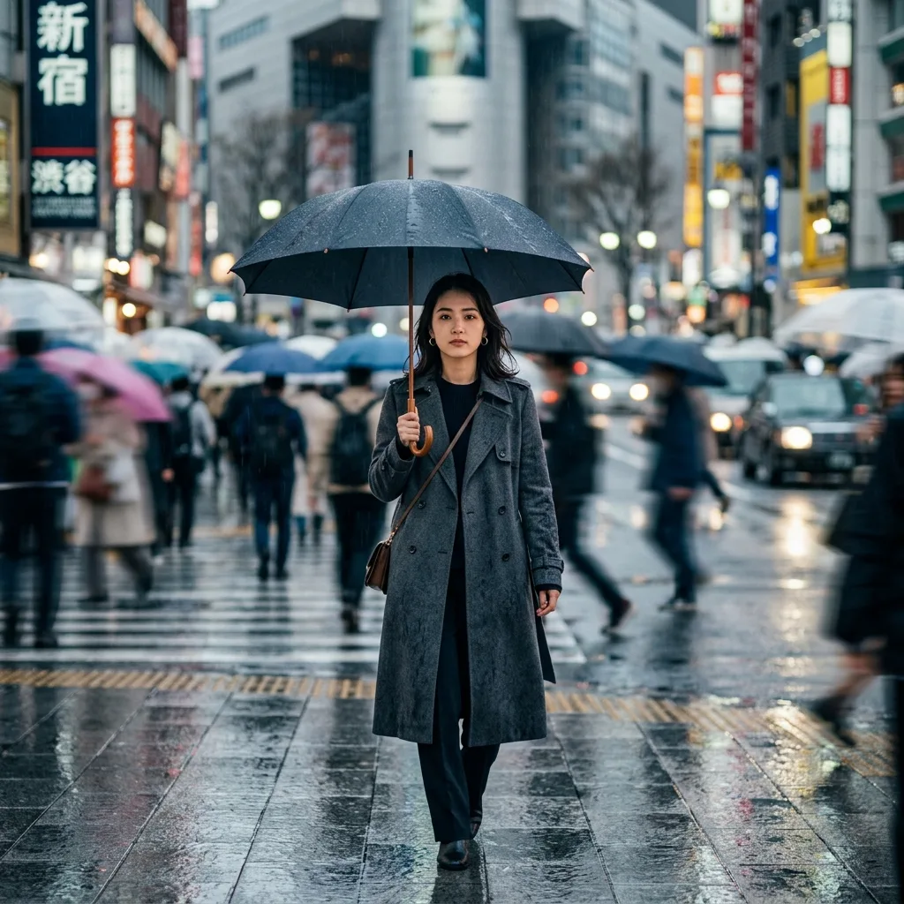

# Girl identical to the reference

[← Back to the collection](../../README.md) · Category: [Photography](../../gallery/photography.md) · Model: `Vinano Image v2` · ID: `vn-00538`

<a href="https://vinano.ai?utm_source=github&utm_medium=readme&utm_campaign=awesome-image-video-prompts-updating&utm_content=prompt-page-image"></a>

<sub>Preview generated with <a href="https://vinano.ai?utm_source=github&utm_medium=readme&utm_campaign=awesome-image-video-prompts-updating&utm_content=prompt-page-caption">vinano.ai</a></sub>

## Prompt

```text
{
 "render_goal": "Ultra-cinematic, hyper-realistic rainy street portrait shallow depth of field",
 "scene": {
 "location": "busy city street",
 "weather": "steady rain, wet reflective roads, soft mist in the air",
 "time": "overcast daytime",
 "atmosphere": "moody, cinematic, emotionally rich"
 },
 "subject": {
 "identity": "girl identical to the reference",
 "action": "walking forward through a crowded street while holding an umbrella",
 "pose": "natural walking posture, relaxed shoulders",
 "expression": "calm, confident, slightly intense",
 "eye_direction": "looking directly at the camera from a distance",
 "outfit": {
 "style": "elegant, modern, attractive",
 "fit": "well-tailored, flattering silhouette",
 "fabric_behavior": "slightly affected by rain, realistic wet textures"
 }
 },
 "composition": {
 "camera_distance": "medium to long shot",
 "framing": "subject centered balanced negative space",
 "angle": "eye-level, cinematic street photography",
 "focus": "razor-sharp focus on the girl only",
 "depth_of_field": "extremely shallow"
 },
 "background": {
 "crowd": "dense crowd walking in all directions",
 "motion": "crowd fully blurred motion blur",
 "detail_level": "faces and bodies indistinguishable",
 "separation": "strong subject-background isolation"
 },
 "lighting": {
 "type": "soft diffused natural light",
 "highlights": "subtle rain highlights and reflections",
 "color_tone": "cool cinematic color grading slight contrast"
 },
 "visual_style": {
 "look": "cinematic street photography",
 "realism": "ultra-realistic skin, fabric, and rain physics",
 "quality": "8K detail, high dynamic range",
 "post_processing": "film-like contrast, subtle grain, no oversharpening"
 },
 "constraints": {
 "accuracy": "match reference pose, framing, mood, and focus precisely",
 "avoid": ["cartoon look",
 "overexposed highlights",
 "extra subjects in focus",
 "stylized or fantasy elements"]
 }
}

Keep edges clean and the overall composition balanced for a polished, gallery-ready result.
```

## Try it on vinano.ai

1. Copy the prompt above.
2. Open **[vinano.ai](https://vinano.ai?utm_source=github&utm_medium=readme&utm_campaign=awesome-image-video-prompts-updating&utm_content=prompt-page-try)**, paste it into the image generator and pick a model.
3. Swap any placeholders (brand, product, city, person…) for your own details, then generate.

More prompts like this: [Photography gallery](../../gallery/photography.md) · [all categories](../../README.md#contents)
