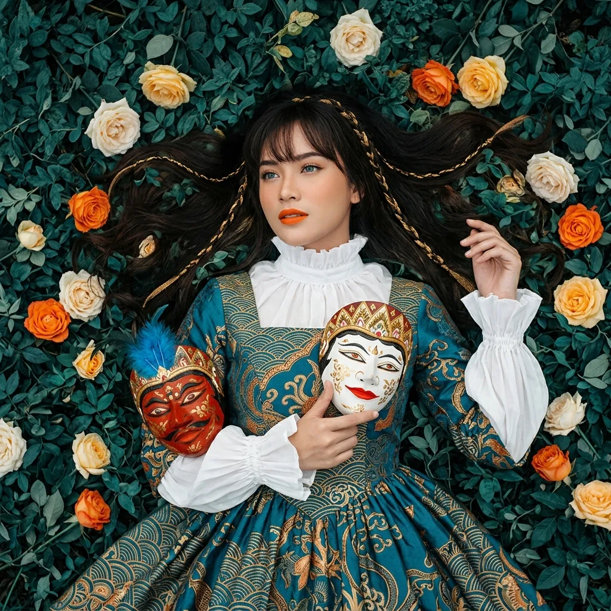

# High ruffled white

[← Back to the collection](../../README.md) · Category: [Photography](../../gallery/photography.md) · Model: `Vinano Image v2` · ID: `vn-00541`

<a href="https://vinano.ai?utm_source=github&utm_medium=readme&utm_campaign=awesome-image-video-prompts-updating&utm_content=prompt-page-image"></a>

<sub>Preview generated with <a href="https://vinano.ai?utm_source=github&utm_medium=readme&utm_campaign=awesome-image-video-prompts-updating&utm_content=prompt-page-caption">vinano.ai</a></sub>

## Prompt

```text
{
 "subject": {
 "hair": {
 "length": "long",
 "color": "dark",
 "style": "flowing, face-framing",
 "bangs": true,
 "accents": {
 "type": "braided",
 "color": "gold"
 }
 },
 "eyes": {
 "color": "light blue",
 "expression": "serene",
 "gaze": "direct"
 },
 "lips": {
 "color": "vibrant orange"
 }
 },

 "attire": {
 "gown": {
 "style": "opulent historical-inspired",
 "main_color": "rich teal-blue",
 "collar": "high ruffled white",
 "sleeves": "voluminous white gathered cuffs",
 "fabric": {
 "pattern": "Indonesian batik + Ukiyo-e wave motifs",
 "pattern_colors": ["gold", "subtle orange"],
 "detail": "intricate"
 }
 }
 },

 "props": {
 "right_hand_mask": {
 "origin": "Indonesian Javanese wayang-inspired",
 "base_color": "white",
 "lips": "red",
 "expression": "happy",
 "decoration": "gold patterns"
 },
 "left_arm_mask": {
 "origin": "Indonesian traditional",
 "base_color": "red",
 "expression": "angry",
 "decoration": "gold patterns",
 "feather_accent": "blue"
 }
 },

 "pose": {
 "composition": "contrapposto",
 "orientation": "slightly facing left",
 "posture": "lying languidly",
 "framing": "centered"
 },

 "shot": {
 "type": "top-down overhead medium shot",
 "focus": "centered on the woman"
 },

 "background": {
 "foliage": {
 "color": "dark teal-green",
 "density": "dense"
 },
 "flowers": [{ "type": "rose", "color": "cream" },
 { "type": "rose", "color": "pale yellow" },
 { "type": "rose", "color": "vibrant orange" }]
 },

 "lighting": {
 "type": "soft diffused",
 "highlights": "gentle",
 "shadows": "soft"
 },

 "palette": ["teal", "orange", "cream", "white", "gold"],

 "style": {
 "mood": "rich and luxurious",
 "detail_level": "high",
 "textures": "ornate and rich",
 "cultural_respect": true
 },

 "camera": {
 "angle": "overhead",
 "shot_size": "medium",
 "depth_of_field": "shallow",
 "crop": "centered"
 },

 "output": {
 "format": "image-edit-prompt"
 }
}

Emphasise material texture and natural light so the final frame feels tactile and premium.
```

## Try it on vinano.ai

1. Copy the prompt above.
2. Open **[vinano.ai](https://vinano.ai?utm_source=github&utm_medium=readme&utm_campaign=awesome-image-video-prompts-updating&utm_content=prompt-page-try)**, paste it into the image generator and pick a model.
3. Swap any placeholders (brand, product, city, person…) for your own details, then generate.

More prompts like this: [Photography gallery](../../gallery/photography.md) · [all categories](../../README.md#contents)
