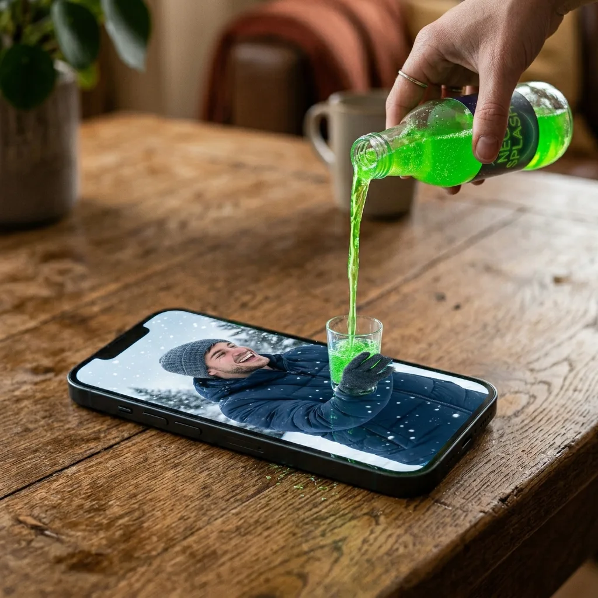

# Surreal photograph of a modern smartphone lying flat

[← Back to the collection](../../README.md) · Category: [Photography](../../gallery/photography.md) · Model: `Vinano Image v2` · ID: `vn-00542`

<a href="https://vinano.ai?utm_source=github&utm_medium=readme&utm_campaign=awesome-image-video-prompts-updating&utm_content=prompt-page-image"></a>

<sub>Preview generated with <a href="https://vinano.ai?utm_source=github&utm_medium=readme&utm_campaign=awesome-image-video-prompts-updating&utm_content=prompt-page-caption">vinano.ai</a></sub>

## Prompt

```text
A hyper-realistic surreal photograph of a modern smartphone lying flat on a wooden table, its screen acting as a portal between two worlds. From inside the phone screen, a smiling young man dressed in winter clothing—puffer jacket, knit beanie, gloves—extends his hands outward into the real world, holding a clear glass. From outside the phone, a real human hand pours a bright neon-green carbonated drink into the glass, liquid splashes frozen mid-air as it crosses the boundary between the digital screen and reality. Snowflakes drift inside the phone screen while the real environment remains warm and minimal. Gemini Ultra-detailed textures, filmic, cinematic lighting, shallow depth of field, true-to-life photorealistic surrealism, high-resolution editorial photography. Maintain consistent colour harmony and crisp focus across the whole frame.
```

## Try it on vinano.ai

1. Copy the prompt above.
2. Open **[vinano.ai](https://vinano.ai?utm_source=github&utm_medium=readme&utm_campaign=awesome-image-video-prompts-updating&utm_content=prompt-page-try)**, paste it into the image generator and pick a model.
3. Swap any placeholders (brand, product, city, person…) for your own details, then generate.

More prompts like this: [Photography gallery](../../gallery/photography.md) · [all categories](../../README.md#contents)
