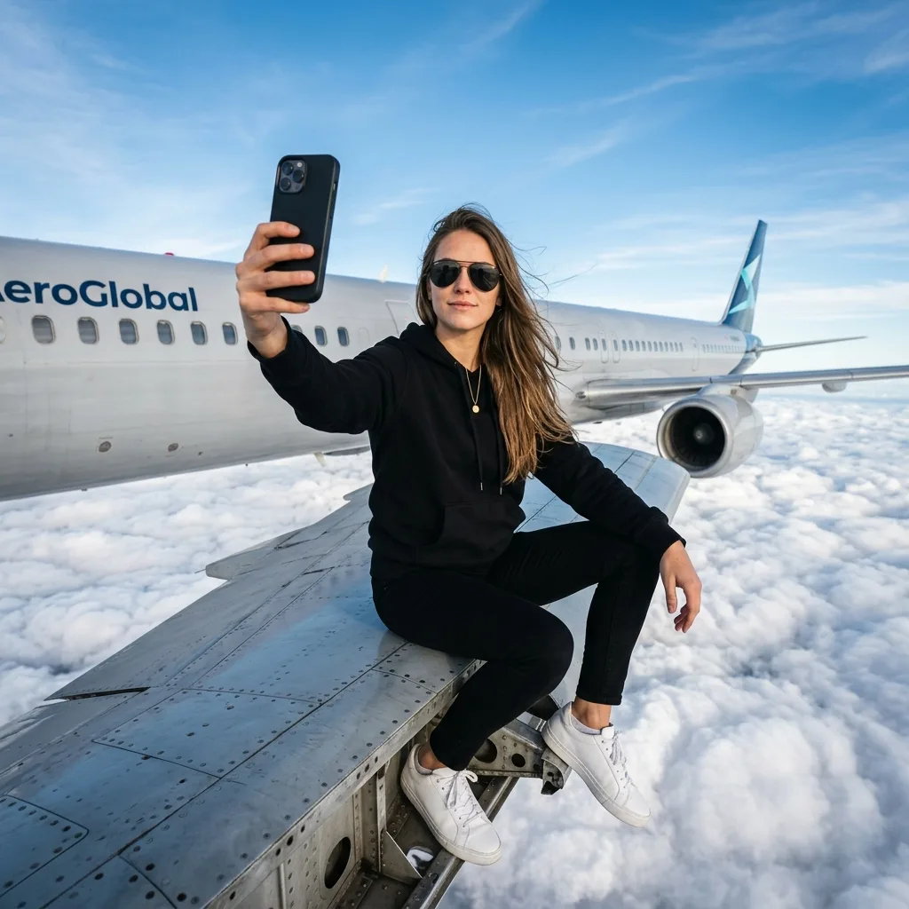

# Stylish young woman sitting on an airplane wing high

[← Back to the collection](../../README.md) · Category: [Photography](../../gallery/photography.md) · Model: `Vinano Image v2` · ID: `vn-00546`

<a href="https://vinano.ai?utm_source=github&utm_medium=readme&utm_campaign=awesome-image-video-prompts-updating&utm_content=prompt-page-image"></a>

<sub>Preview generated with <a href="https://vinano.ai?utm_source=github&utm_medium=readme&utm_campaign=awesome-image-video-prompts-updating&utm_content=prompt-page-caption">vinano.ai</a></sub>

## Prompt

```text
{
 "image_generation": {
 "subject": {
 "description": "stylish young woman sitting on an airplane wing high above the clouds",
 "pose": "seated casually on the airplane wing, one hand extended forward as if taking a selfie, relaxed but confident posture",
 "expression": "calm, confident, composed",
 "gaze": "looking toward the camera a cool, self-assured expression"
 },
 "appearance": {
 "hair": {
 "style": "long, natural, slightly flowing in the wind",
 "look": "casual and effortless"
 },
 "accessories": ["dark sunglasses",
 "minimal jewelry"],
 "vibe": "adventurous, bold, modern"
 },
 "outfit": {
 "style": "sporty casual",
 "details": "black hoodie, black fitted pants, clean white sneakers"
 },
 "environment": {
 "setting": "high above the clouds on an airplane wing",
 "sky": "clear blue sky soft clouds below",
 "atmosphere": "open, airy, dramatic aerial view"
 },
 "lighting": {
 "type": "natural sunlight",
 "style": "bright and cinematic",
 "direction": "side lighting from the sun",
 "quality": "crisp highlights soft shadows"
 },
 "camera": {
 "angle": "wide selfie-style perspective from a slightly elevated angle",
 "lens": "ultra wide-angle",
 "depth_of_field": "deep focus capturing both subject and vast sky background",
 "composition": "dynamic, adventurous framing emphasizing height and openness"
 },
 "aesthetic": {
 "style": "cinematic adventure photography",
 "vibe": "bold, fearless, modern, travel lifestyle",
 "color_grading": "clean cinematic tones natural blues and soft contrast"
 },
 "quality": {
 "realism": "true-to-life photorealistic",
 "detail": "high detail",
 "resolution": "high resolution",
 "finish": "professional, crisp, ultra-realistic"
 }
 }
}

Keep edges clean and the overall composition balanced for a polished, gallery-ready result.
```

## Try it on vinano.ai

1. Copy the prompt above.
2. Open **[vinano.ai](https://vinano.ai?utm_source=github&utm_medium=readme&utm_campaign=awesome-image-video-prompts-updating&utm_content=prompt-page-try)**, paste it into the image generator and pick a model.
3. Swap any placeholders (brand, product, city, person…) for your own details, then generate.

More prompts like this: [Photography gallery](../../gallery/photography.md) · [all categories](../../README.md#contents)
