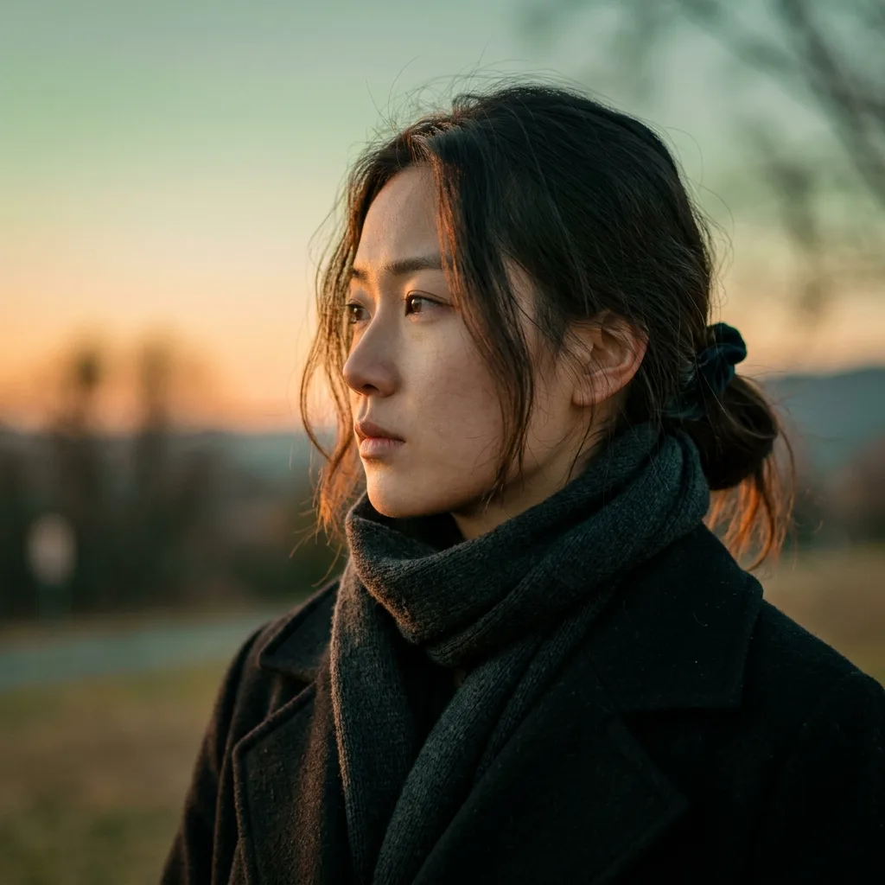

# True-to-life photorealistic cinematic portrait of a young East Asian

[← Back to the collection](../../README.md) · Category: [Photography](../../gallery/photography.md) · Model: `Vinano Image v2` · ID: `vn-00549`

<a href="https://vinano.ai?utm_source=github&utm_medium=readme&utm_campaign=awesome-image-video-prompts-updating&utm_content=prompt-page-image"></a>

<sub>Preview generated with <a href="https://vinano.ai?utm_source=github&utm_medium=readme&utm_campaign=awesome-image-video-prompts-updating&utm_content=prompt-page-caption">vinano.ai</a></sub>

## Prompt

```text
true-to-life photorealistic cinematic portrait of a young East Asian woman standing outdoors at sunset, side-profile close-up, looking thoughtfully into the distance. Soft golden hour lighting illuminating one side of her face, warm orange and teal color grading. She wears a black coat and dark scarf, hair loosely tied back soft natural strands around her face. Natural skin texture, realistic facial details, minimal makeup. Shallow depth of field blurred landscape background, smooth bokeh, dramatic atmospheric mood, soft gradient sky transitioning from warm orange to cool green tones. Shot on 85mm lens, f/1.8, ultra-realistic, high dynamic range, cinematic composition, moody, film still aesthetic. Maintain consistent colour harmony and crisp focus across the whole frame.
```

## Try it on vinano.ai

1. Copy the prompt above.
2. Open **[vinano.ai](https://vinano.ai?utm_source=github&utm_medium=readme&utm_campaign=awesome-image-video-prompts-updating&utm_content=prompt-page-try)**, paste it into the image generator and pick a model.
3. Swap any placeholders (brand, product, city, person…) for your own details, then generate.

More prompts like this: [Photography gallery](../../gallery/photography.md) · [all categories](../../README.md#contents)
