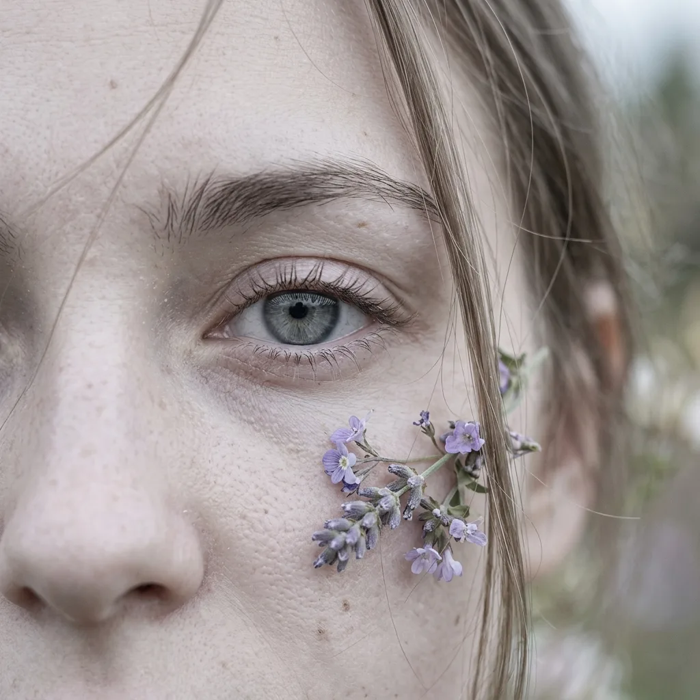

# Utilize exclusively and obligatorily the uploaded reference photos as

[← Back to the collection](../../README.md) · Category: [Photography](../../gallery/photography.md) · Model: `Vinano Image Pro` · ID: `vn-00557`

<a href="https://vinano.ai?utm_source=github&utm_medium=readme&utm_campaign=awesome-image-video-prompts-updating&utm_content=prompt-page-image"></a>

<sub>Preview generated with <a href="https://vinano.ai?utm_source=github&utm_medium=readme&utm_campaign=awesome-image-video-prompts-updating&utm_content=prompt-page-caption">vinano.ai</a></sub>

## Prompt

```text
Utilize exclusively and obligatorily the uploaded reference photos as the primary and authoritative source for the model’s face, facial structure, proportions, skin tone, real skin texture, and the exact natural characteristics of her hair.
Do not idealize, beautify, alter, rejuvenate, slim the face, smooth the skin, or modify any real features.
Do not remove or change freckles, pores, fine lines, or natural imperfections.The appearance must match the reference images exactly, absolute fidelity.
Create a hyper-realistic, ethereal macro Fine Art portrait photograph, captured a Leica APO-Macro-Elmarit-R 100mm f/2.8, full-frame.
An extreme close-up of a young woman’s face pale skin, fully respecting the real physiognomy of the model as shown in the reference photos.
Skin texture is ultra-detailed and completely natural, clearly visible pores and no artificial smoothing.
One crystal-clear, melancholic eye is in perfect critical focus, displaying natural micro-contrast characteristic of Leica optics.
Long, natural eyelashes.
Lips slightly parted, in a natural pale pink tone, no excessive or artificial makeup.
Delicate wildflowers in soft lilac and muted purple tones rest gently on the cheek and intertwine loose, naturally imperfect hair strands, exactly following the real hair pattern seen in the reference images.
Some flowers appear softly out of focus in the foreground, creating organic depth and layered composition.
Soft, cool, diffused natural light, as on an overcast day.
No harsh shadows, no artificial lighting.
A serene, fragile, poetic, and subtly melancholic atmosphere.
Macro photography an extremely shallow depth of field, edges and background melting into a creamy, smooth bokeh.
Absolute critical focus on the iris and the true skin texture.
Desaturated color palette, cool pastel tones — soft gray, beige, and lilac.
Fine Art aesthetic, authentic Leica optical fidelity, true photographic appearance.
Ultra-high resolution 8K, no AI-generated look.

Preserve realistic proportions and depth for a confident, professional finish.
```

## Try it on vinano.ai

1. Copy the prompt above.
2. Open **[vinano.ai](https://vinano.ai?utm_source=github&utm_medium=readme&utm_campaign=awesome-image-video-prompts-updating&utm_content=prompt-page-try)**, paste it into the image generator and pick a model.
3. Swap any placeholders (brand, product, city, person…) for your own details, then generate.

More prompts like this: [Photography gallery](../../gallery/photography.md) · [all categories](../../README.md#contents)
