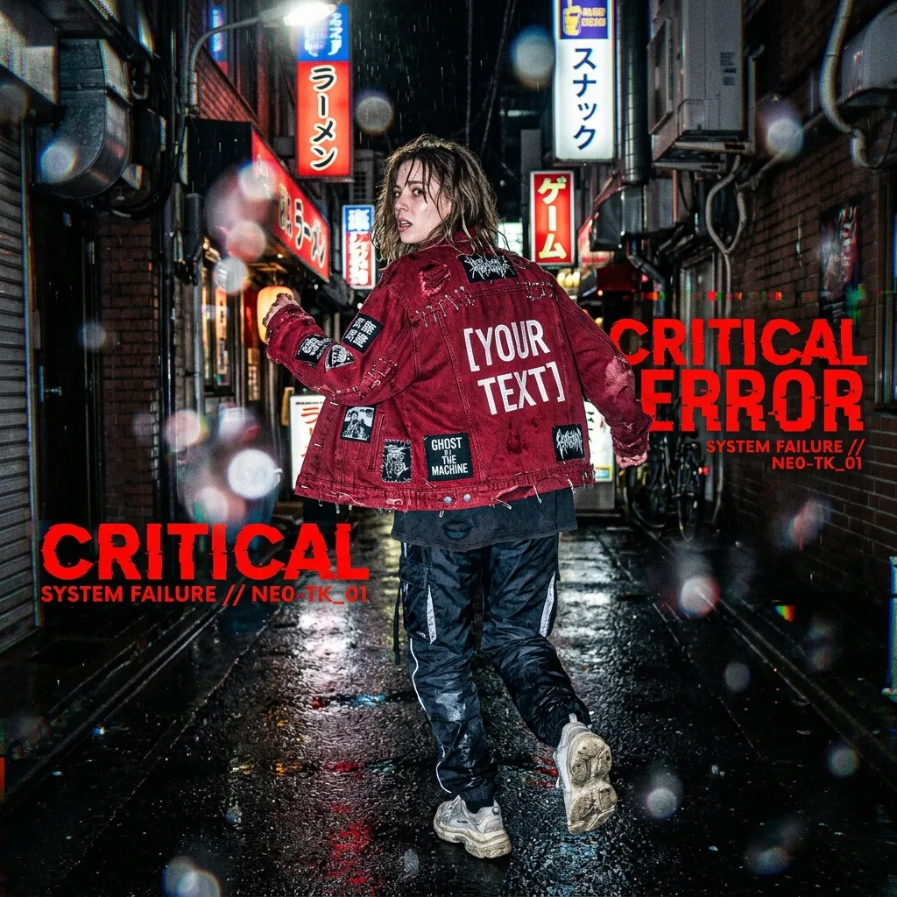

# Raw, candid street-style shot of reference running through

[← Back to the collection](../../README.md) · Category: [Photography](../../gallery/photography.md) · Model: `Vinano Image v2` · ID: `vn-00559`

<a href="https://vinano.ai?utm_source=github&utm_medium=readme&utm_campaign=awesome-image-video-prompts-updating&utm_content=prompt-page-image"></a>

<sub>Preview generated with <a href="https://vinano.ai?utm_source=github&utm_medium=readme&utm_campaign=awesome-image-video-prompts-updating&utm_content=prompt-page-caption">vinano.ai</a></sub>

## Prompt

```text
A raw, candid street-style shot of reference running through a rain-soaked Neo-Tokyo alleyway, glancing over her shoulder. She is wearing an oversized "Crimson Red" distressed denim jacket safety pins and patches, the [YOUR TEXT] branding is embroidered in white on the back. Underneath, a torn band tee. Raindrops on the camera lens create natural distortion. The background is blurred red neon signs reflecting on wet asphalt. The image is heavily processed "Critical Error" red text overlays and glitch artifacts. Style: Flash photography, high contrast, adrenaline rush. Aim for an editorial, design-driven look with deliberate negative space.
```

## Try it on vinano.ai

1. Copy the prompt above.
2. Open **[vinano.ai](https://vinano.ai?utm_source=github&utm_medium=readme&utm_campaign=awesome-image-video-prompts-updating&utm_content=prompt-page-try)**, paste it into the image generator and pick a model.
3. Swap any placeholders (brand, product, city, person…) for your own details, then generate.

More prompts like this: [Photography gallery](../../gallery/photography.md) · [all categories](../../README.md#contents)
