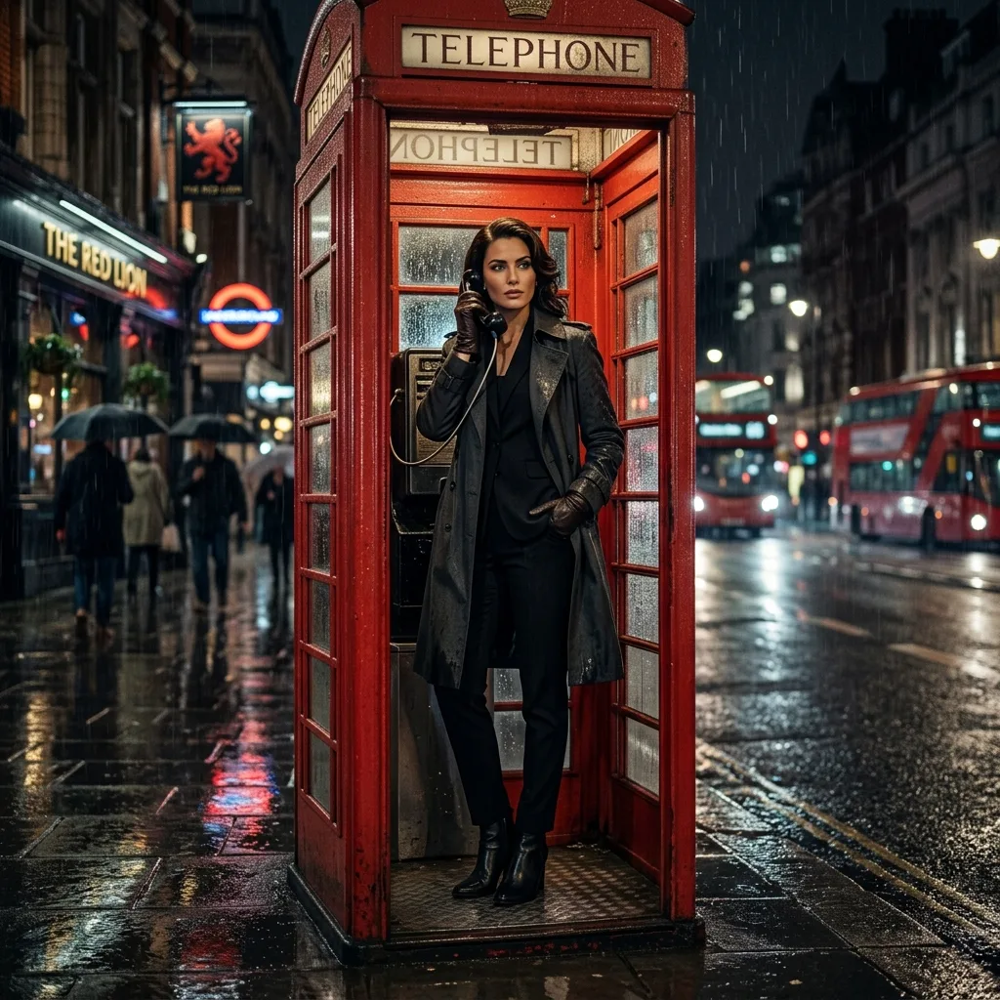

# Fit, elegant, confident presence

[← Back to the collection](../../README.md) · Category: [Photography](../../gallery/photography.md) · Model: `Vinano Image Pro` · ID: `vn-00561`

<a href="https://vinano.ai?utm_source=github&utm_medium=readme&utm_campaign=awesome-image-video-prompts-updating&utm_content=prompt-page-image"></a>

<sub>Preview generated with <a href="https://vinano.ai?utm_source=github&utm_medium=readme&utm_campaign=awesome-image-video-prompts-updating&utm_content=prompt-page-caption">vinano.ai</a></sub>

## Prompt

```text
{
 "type": "image_generation_prompt",
 "style": "ultra-true-to-life photorealistic, cinematic, high-end fashion editorial",
 "aspect_ratio": "1:1",
 "resolution": "high resolution, maximum realism",
 "scene": {
 "time": "night",
 "weather": "rainy",
 "location": "urban London street"
 },
 "environment": {
 "primary_setting": "inside a classic red British telephone booth",
 "ground": "wet pavement reflecting city lights",
 "atmosphere": ["visible raindrops under soft street lighting",
 "subtle fog in the background",
 "blurred headlights",
 "cinematic bokeh lights"]
 },
 "subject": {
 "gender": "female",
 "appearance": {
 "physique": "fit, elegant, confident presence",
 "expression": "serious, confident, charismatic",
 "pose": {
 "full_body_visible": true,
 "stance": "standing inside the telephone booth",
 "right_hand": "holding the old-fashioned phone receiver",
 "left_hand": "casually inside coat pocket"
 }
 },
 "clothing": {
 "outfit": "tailored black suit",
 "outerwear": "long dark trench coat slightly wet from rain",
 "style": "elegant, cinematic, fashion editorial"
 }
 },
 "lighting": {
 "type": "moody cinematic street lighting",
 "effects": ["dramatic contrast",
 "realistic rain reflections on glass panels",
 "soft highlights on wet surfaces",
 "natural reflections from city lights"]
 },
 "camera": {
 "framing": "full-body shot from head to toe",
 "composition": "centered subject inside telephone booth",
 "focus": "sharp focus on subject, soft blur in background",
 "style": "cinematic photography"
 },
 "mood": {
 "tone": "dark, elegant, cinematic",
 "aesthetic": "high-end fashion editorial urban atmosphere"
 },
 "constraints": ["no cartoon or illustration",
 "no unrealistic lighting",
 "no distortion",
 "no watermark",
 "no text"],
 "output_goal": "Create an ultra-true-to-life photorealistic cinematic night scene of a confident woman standing inside a classic red British telephone booth in rainy London, dramatic lighting, realistic reflections, and a high-end fashion editorial aesthetic."
}

Keep edges clean and the overall composition balanced for a polished, gallery-ready result.
```

## Try it on vinano.ai

1. Copy the prompt above.
2. Open **[vinano.ai](https://vinano.ai?utm_source=github&utm_medium=readme&utm_campaign=awesome-image-video-prompts-updating&utm_content=prompt-page-try)**, paste it into the image generator and pick a model.
3. Swap any placeholders (brand, product, city, person…) for your own details, then generate.

More prompts like this: [Photography gallery](../../gallery/photography.md) · [all categories](../../README.md#contents)
