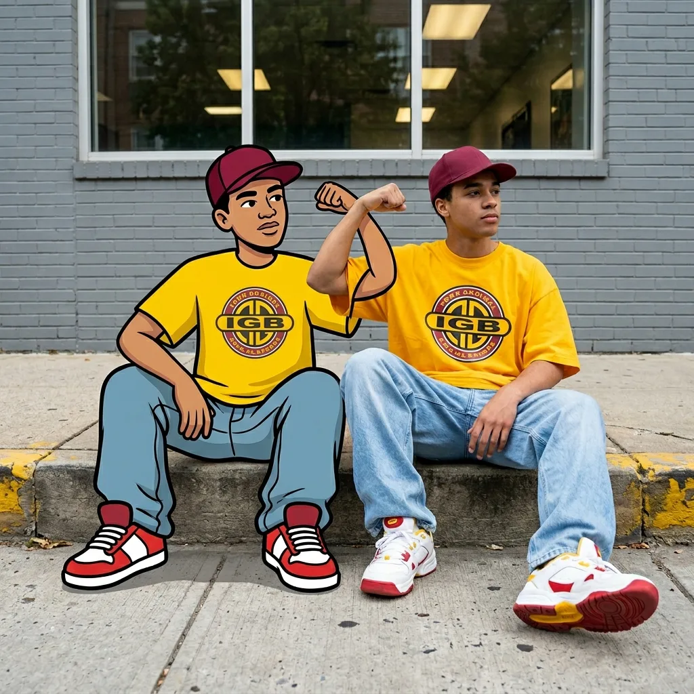

# Transform this image Upload Your Image into a 64K

[← Back to the collection](../../README.md) · Category: [Photography](../../gallery/photography.md) · Model: `Vinano Image Pro` · ID: `vn-00563`

<a href="https://vinano.ai?utm_source=github&utm_medium=readme&utm_campaign=awesome-image-video-prompts-updating&utm_content=prompt-page-image"></a>

<sub>Preview generated with <a href="https://vinano.ai?utm_source=github&utm_medium=readme&utm_campaign=awesome-image-video-prompts-updating&utm_content=prompt-page-caption">vinano.ai</a></sub>

## Prompt

```text
Transform this image [Upload Your Image] into a 64K DSLR shot resolution of A creative mixed-reality street portrait featuring a real young man (same face as the uploaded image) sitting on concrete steps beside his illustrated cartoon counterpart. The scene is set outdoors against a gray brick wall a large window above, reflecting trees and indoor lighting, giving an urban neighborhood feel. The sidewalk and steps have worn yellow paint along the edges, adding texture and realism.
On the right sits the real person, a young man (same face as the uploaded image) dressed in early-2000s hip-hop streetwear. He wears an oversized bright yellow graphic T-shirt a bold circular logo, loose light-blue baggy jeans, white & red chunky sneakers yellow detailing, and a maroon baseball cap worn forward. He poses casually, seated legs extended, one arm flexed at the elbow as if showing strength or confidence, looking off to the side a calm, cool expression.
On the left sits his cartoon illustrated version of himself (same face as the uploaded image) perfectly matching his outfit, pose, and proportions. The cartoon character is drawn in a flat, bold, graphic style thick black outlines, simplified facial features, and vibrant colors. The illustrated figure mirrors the real person’s posture and clothing exactly same, including the oversized shirt, baggy jeans, red & white sneakers, and maroon cap. The cartoon arm connects visually the real person’s arm, creating a playful illusion of interaction between illustration and reality. The illustration style resembles hand-drawn street art or animated hip-hop character design, seamlessly integrated into the photograph accurate scale, alignment, and grounding. The contrast between realistic textures (concrete, brick, denim fabric) and the clean, flat cartoon shading creates a striking visual effect. Lighting is natural daylight, evenly illuminating both the real and illustrated subjects. The overall mood is cool, nostalgic, playful, and creative, blending street fashion, urban culture, and cartoon art into a cohesive mixed-media composition. Style & Mood Keywords: Mixed media photography, real person cartoon twin, urban street portrait, hip-hop fashion, Y2K streetwear, bold graphic illustration, cartoon realism blend, playful surrealism, nostalgic urban culture, high-resolution detail, creative storytelling. Octane render & Unreal Engine 5.

Aim for an editorial, design-driven look with deliberate negative space.
```

## Try it on vinano.ai

1. Copy the prompt above.
2. Open **[vinano.ai](https://vinano.ai?utm_source=github&utm_medium=readme&utm_campaign=awesome-image-video-prompts-updating&utm_content=prompt-page-try)**, paste it into the image generator and pick a model.
3. Swap any placeholders (brand, product, city, person…) for your own details, then generate.

More prompts like this: [Photography gallery](../../gallery/photography.md) · [all categories](../../README.md#contents)
