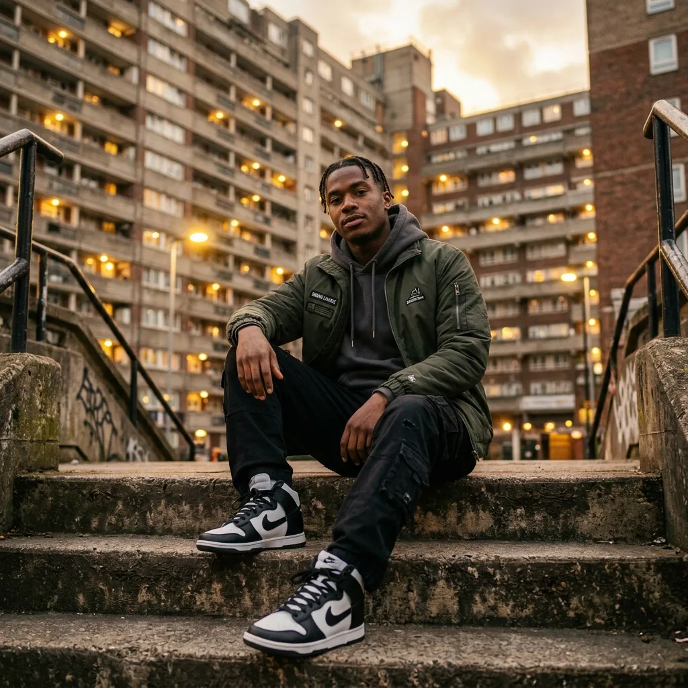

# Stylish young man sitting confidently on raw concrete steps

[← Back to the collection](../../README.md) · Category: [Photography](../../gallery/photography.md) · Model: `Vinano Image v2` · ID: `vn-00564`

<a href="https://vinano.ai?utm_source=github&utm_medium=readme&utm_campaign=awesome-image-video-prompts-updating&utm_content=prompt-page-image"></a>

<sub>Preview generated with <a href="https://vinano.ai?utm_source=github&utm_medium=readme&utm_campaign=awesome-image-video-prompts-updating&utm_content=prompt-page-caption">vinano.ai</a></sub>

## Prompt

```text
A stylish young man sitting confidently on raw concrete steps inside a dense urban housing complex during golden hour. He wears a hooded sweatshirt layered under a premium streetwear jacket minimal embroidered patches, relaxed cargo pants, and bold high-top sneakers. Shot from a low, slightly wide angle to enhance dominance and attitude. Warm golden sunlight from the setting sun and street lamps creates long shadows, glowing highlights on the face, and cinematic depth. Tall apartment buildings softly lit windows fill the background. Ultra-realistic DSLR look, shallow depth of field, crisp fabric textures, natural skin tones, subtle film grain, Instagram-trending urban vibe, 4K quality. Preserve realistic proportions and depth for a confident, professional finish.
```

## Try it on vinano.ai

1. Copy the prompt above.
2. Open **[vinano.ai](https://vinano.ai?utm_source=github&utm_medium=readme&utm_campaign=awesome-image-video-prompts-updating&utm_content=prompt-page-try)**, paste it into the image generator and pick a model.
3. Swap any placeholders (brand, product, city, person…) for your own details, then generate.

More prompts like this: [Photography gallery](../../gallery/photography.md) · [all categories](../../README.md#contents)
