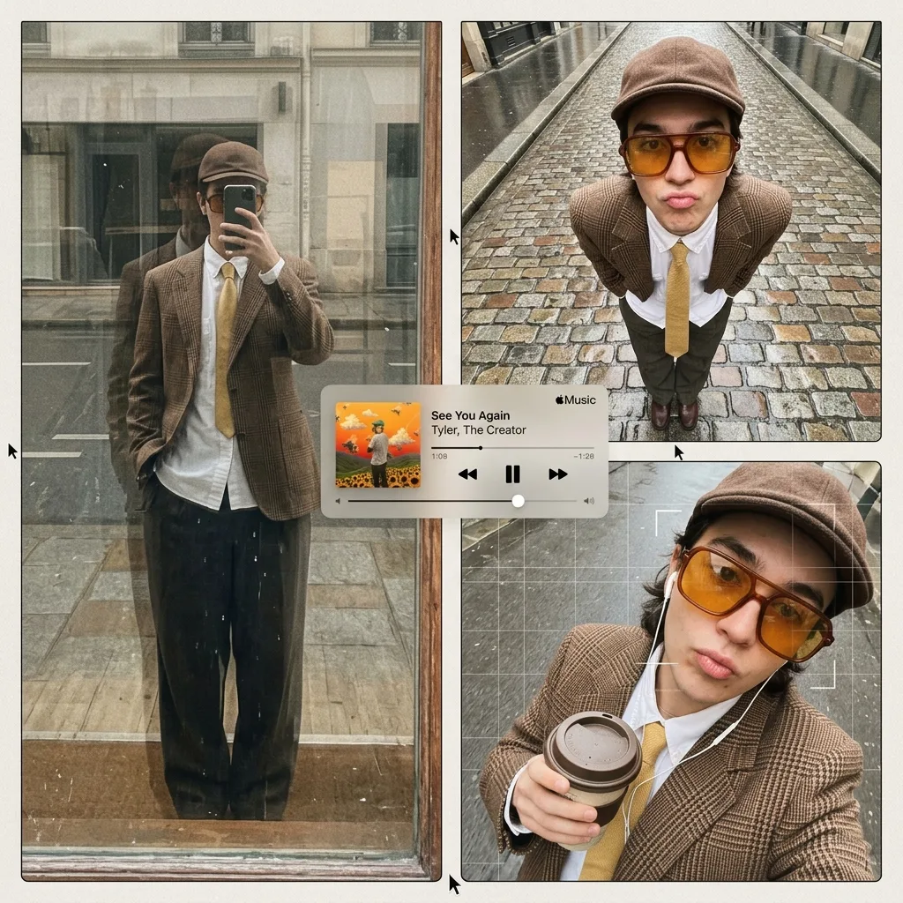

# Poster-style multi-panel collage presents Subject person in the image

[← Back to the collection](../../README.md) · Category: [Photography](../../gallery/photography.md) · Model: `Vinano Image Pro` · ID: `vn-00568`

<a href="https://vinano.ai?utm_source=github&utm_medium=readme&utm_campaign=awesome-image-video-prompts-updating&utm_content=prompt-page-image"></a>

<sub>Preview generated with <a href="https://vinano.ai?utm_source=github&utm_medium=readme&utm_campaign=awesome-image-video-prompts-updating&utm_content=prompt-page-caption">vinano.ai</a></sub>

## Prompt

```text
An editorial poster-style multi-panel collage presents Subject[person in the image] across three asymmetric photographic frames, unified by a muted-brown urban streetwear aesthetic and a retro analog-digital fusion mood. The top-left frame captures a reflective window shot where the subject holds a phone in front of their face, dressed in a brown plaid blazer layered over a white button-up shirt, a yellow tie, loose dark trousers, and a brown cap; the reflective surface introduces layered ghosting, faint architectural overlays, and a subtly stretched full-body silhouette shaped by the curvature of the glass.

The top-right frame shifts into a close-range, downward-angled ultra-wide portrait taken on a cobblestone street, where the subject leans forward hands in pockets and lips exaggeratedly pouting, wearing the same outfit now paired oversized amber-tinted rectangular sunglasses, while the cobblestones warp and radiate outward due to lens perspective distortion.

The bottom-right frame becomes an intimate overhead selfie the subject holding a drink, still in the same wardrobe but now wired earphones, the amber sunglasses dominating the frame under soft overcast lighting, enhanced by faint digital-grid overlays and a minimal square facial-bounding graphic.

Floating across the middle section of the poster is a translucent iOS-style Apple Music mini-player displaying "See You Again" by Tyler, The Creator, featuring artwork, timeline, and playback controls without shadows, contributing to the minimal Ul aesthetic alongside subtle cursor-like frame lines and rectangular highlights around the collage edges.

The overall palette emphasizes warm ambers, washed neutrals, soft greys, reflective textures, wool plaid patterning, polished leather, and stone pavement, all rendered realistic lighting and natural distortion patterns while avoiding stickers, extra subjects, wardrobe changes, incorrect Ul icons, neon color shifts, or any futuristic sci-fi elements.

Render with rich micro-detail while keeping the layout uncluttered and intentional.
```

## Try it on vinano.ai

1. Copy the prompt above.
2. Open **[vinano.ai](https://vinano.ai?utm_source=github&utm_medium=readme&utm_campaign=awesome-image-video-prompts-updating&utm_content=prompt-page-try)**, paste it into the image generator and pick a model.
3. Swap any placeholders (brand, product, city, person…) for your own details, then generate.

More prompts like this: [Photography gallery](../../gallery/photography.md) · [all categories](../../README.md#contents)
