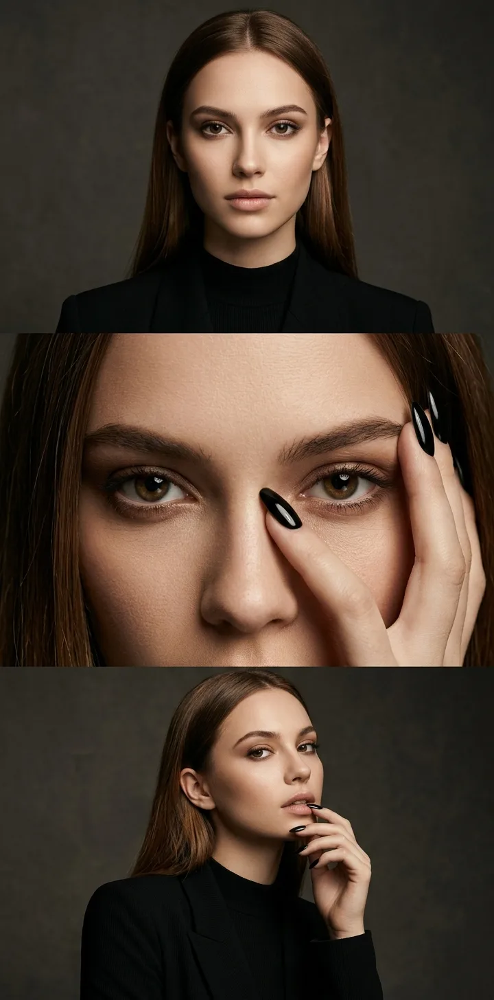

# Photography prompt #575

[← Back to the collection](../../README.md) · Category: [Photography](../../gallery/photography.md) · Model: `Vinano Image v2` · ID: `vn-00575`

<a href="https://vinano.ai?utm_source=github&utm_medium=readme&utm_campaign=awesome-image-video-prompts-updating&utm_content=prompt-page-image"></a>

<sub>Preview generated with <a href="https://vinano.ai?utm_source=github&utm_medium=readme&utm_campaign=awesome-image-video-prompts-updating&utm_content=prompt-page-caption">vinano.ai</a></sub>

## Prompt

```text
{
 "Objective": "Create a high-fashion editorial studio portrait presented as a vertical triptych cinematic luxury aesthetics",
 "PersonaDetails": {
 "Subject": {
 "Type": "Young woman",
 "Hair": "Long, sleek chestnut-brown hair",
 "Makeup": {
 "Style": "Natural, flawless skin",
 "Emphasis": "Eyes subtly enhanced for intensity"
 },
 "Wardrobe": "refined minimalist black outfit",
 "OverallPresence": "Calm, confident, refined"
 }
 },
 "TriptychComposition": {
 "Layout": "Vertical triptych (three stacked frames)",
 "TopFrame": {
 "Framing": "Centered head-and-shoulders portrait",
 "Pose": "Straight-on, symmetrical composition",
 "Expression": "Calm, confident",
 "Focus": "Balanced facial proportions and elegance"
 },
 "MiddleFrame": {
 "Framing": "Extreme close-up of the eyes",
 "Focus": "Eyes in razor-sharp focus",
 "PoseDetail": "Hand partially covering the face",
 "Accessories": "Long, glossy black nails prominently visible",
 "Mood": "Intimate, intense, editorial"
 },
 "BottomFrame": {
 "Framing": "Three-quarter portrait",
 "Pose": "Hand posed elegantly near the lips",
 "Expression": "Subtle, poised, fashion-forward",
 "Focus": "Gesture, styling, and body language"
 }
 },
 "LightingAndAtmosphere": {
 "LightingStyle": "Dramatic directional studio lighting",
 "LightQuality": "Soft shadows sculpted highlights",
 "Contrast": "Cinematic, high contrast",
 "Background": "Neutral dark studio backdrop"
 },
 "ArtDirection": {
 "Style": "Luxury beauty campaign",
 "Aesthetic": "Vogue-style high-fashion editorial",
 "SkinRendering": "Flawless yet natural skin texture",
 "DetailLevel": "Ultra-detailed refined realism"
 },
 "PhotographyStyle": {
 "Genre": "High-fashion editorial studio photography",
 "CompositionFeel": "Clean, bold, graphic",
 "ImageQuality": "High resolution, premium commercial finish"
 },
 "Mood": {
 "Tone": "Elegant, powerful, modern",
 "Energy": "Confident, controlled, luxurious"
 },
 "NegativePrompt": ["casual fashion",
 "street photography",
 "overly dramatic makeup",
 "soft focus eyes",
 "busy background",
 "oversaturated colors",
 "low contrast",
 "plastic skin"],
 "ResponseFormat": {
 "Type": "Single composite image",
 "Layout": "Vertical triptych",
 "Orientation": "Portrait",
 "AspectRatio": "1:2"
 }
}

Emphasise material texture and natural light so the final frame feels tactile and premium.
```

## Try it on vinano.ai

1. Copy the prompt above.
2. Open **[vinano.ai](https://vinano.ai?utm_source=github&utm_medium=readme&utm_campaign=awesome-image-video-prompts-updating&utm_content=prompt-page-try)**, paste it into the image generator and pick a model.
3. Swap any placeholders (brand, product, city, person…) for your own details, then generate.

More prompts like this: [Photography gallery](../../gallery/photography.md) · [all categories](../../README.md#contents)
