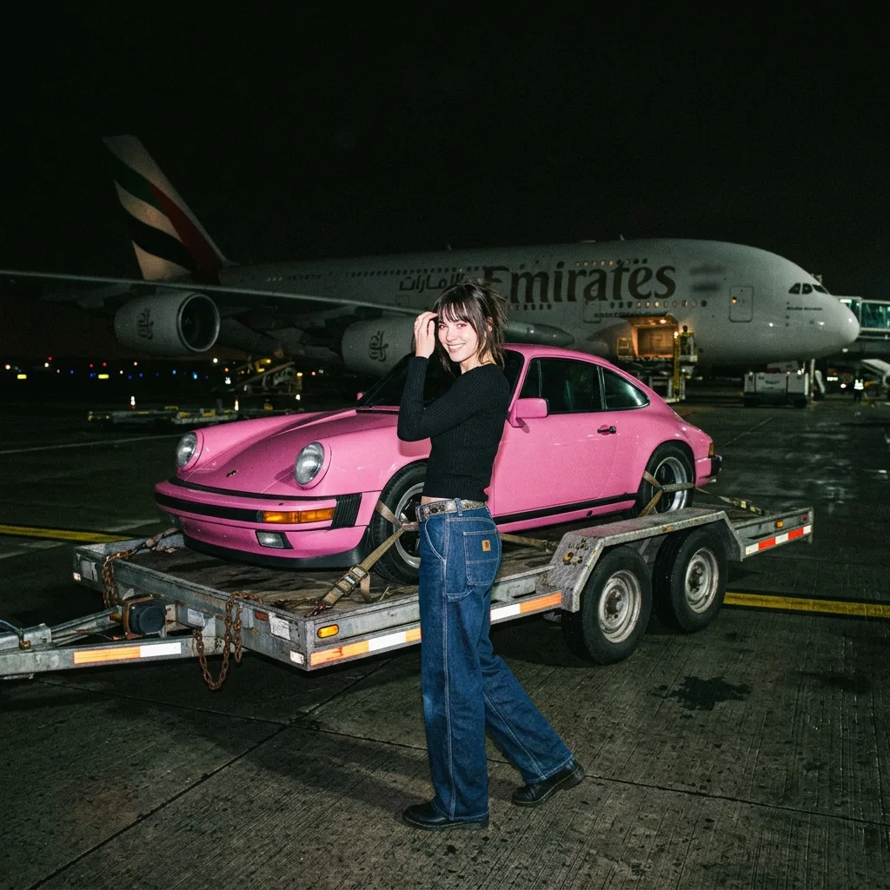

# Gritty, handheld iPhone photo taken at night

[← Back to the collection](../../README.md) · Category: [Photography](../../gallery/photography.md) · Model: `Vinano Image v2` · ID: `vn-00582`

<a href="https://vinano.ai?utm_source=github&utm_medium=readme&utm_campaign=awesome-image-video-prompts-updating&utm_content=prompt-page-image"></a>

<sub>Preview generated with <a href="https://vinano.ai?utm_source=github&utm_medium=readme&utm_campaign=awesome-image-video-prompts-updating&utm_content=prompt-page-caption">vinano.ai</a></sub>

## Prompt

```text
A gritty, handheld iPhone photo taken at night on an airport tarmac harsh direct on-camera flash. Imperfect, slightly crooked framing, like a spon-taneous snap. In the foreground, the woman stands beside a pink Porsche 911 on a flatbed trailer, mid-coy gesture, body angled three-quarters, one hand near her face. She wears wide Carhartt-style jeans and a fitted top, straight bangs framing her face flirty, casual, unplanned. In the background, a huge Emirates Airbus A380 looms in darkness, barely visible beyond flash falloff, cargo door open. Blown highlights on her, hard shadows on concrete, the plane mostly swallowed by night. Render with rich micro-detail while keeping the layout uncluttered and intentional.
```

## Try it on vinano.ai

1. Copy the prompt above.
2. Open **[vinano.ai](https://vinano.ai?utm_source=github&utm_medium=readme&utm_campaign=awesome-image-video-prompts-updating&utm_content=prompt-page-try)**, paste it into the image generator and pick a model.
3. Swap any placeholders (brand, product, city, person…) for your own details, then generate.

More prompts like this: [Photography gallery](../../gallery/photography.md) · [all categories](../../README.md#contents)
