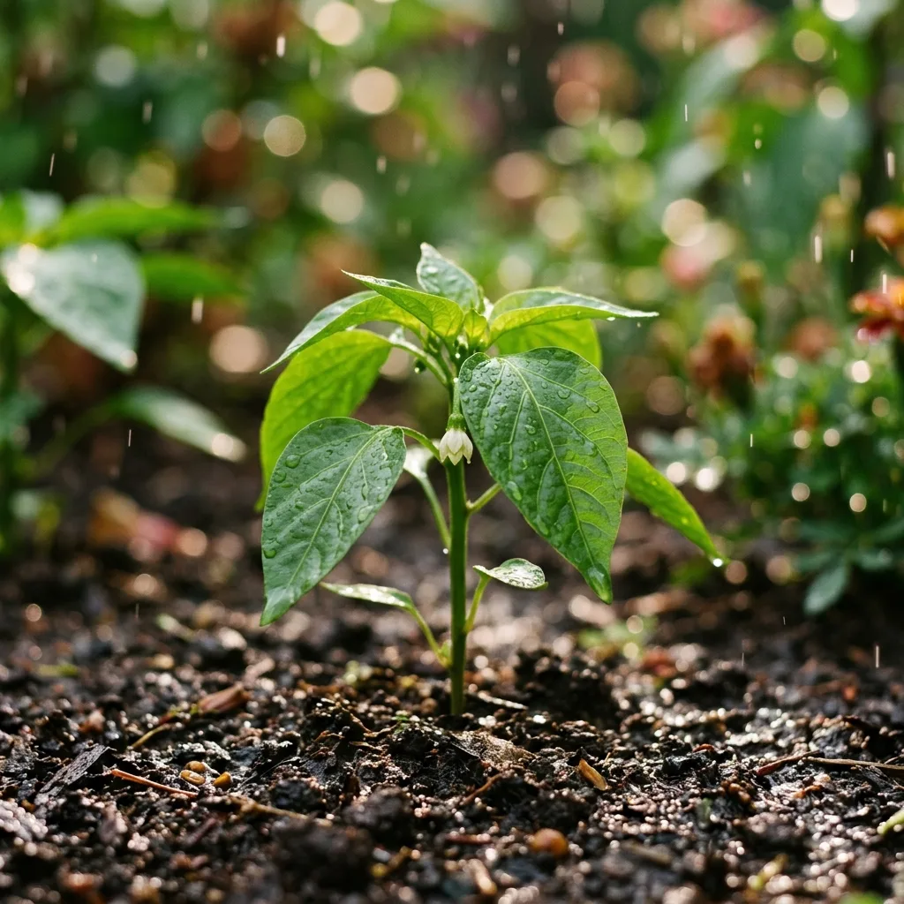

# Small chili plant glossy green leaves and one tiny

[← Back to the collection](../../README.md) · Category: [Photography](../../gallery/photography.md) · Model: `Vinano Image v2` · ID: `vn-00583`

<a href="https://vinano.ai?utm_source=github&utm_medium=readme&utm_campaign=awesome-image-video-prompts-updating&utm_content=prompt-page-image"></a>

<sub>Preview generated with <a href="https://vinano.ai?utm_source=github&utm_medium=readme&utm_campaign=awesome-image-video-prompts-updating&utm_content=prompt-page-caption">vinano.ai</a></sub>

## Prompt

```text
A small chili plant glossy green leaves and one tiny white flower bud forming, emerging from dark damp soil. Light rain falling gently, droplets visible mid-air. Ground-level camera angle, intense macro detail on leaf veins and wet soil granules. Soft daylight warm evening tones, natural reflections on wet surfaces. Background garden softly blurred circular bokeh highlights. Backlit leaves subtle translucency. Shot on 100mm macro lens, shallow depth of field, f/2.8 Maintain consistent colour harmony and crisp focus across the whole frame.
```

## Try it on vinano.ai

1. Copy the prompt above.
2. Open **[vinano.ai](https://vinano.ai?utm_source=github&utm_medium=readme&utm_campaign=awesome-image-video-prompts-updating&utm_content=prompt-page-try)**, paste it into the image generator and pick a model.
3. Swap any placeholders (brand, product, city, person…) for your own details, then generate.

More prompts like this: [Photography gallery](../../gallery/photography.md) · [all categories](../../README.md#contents)
