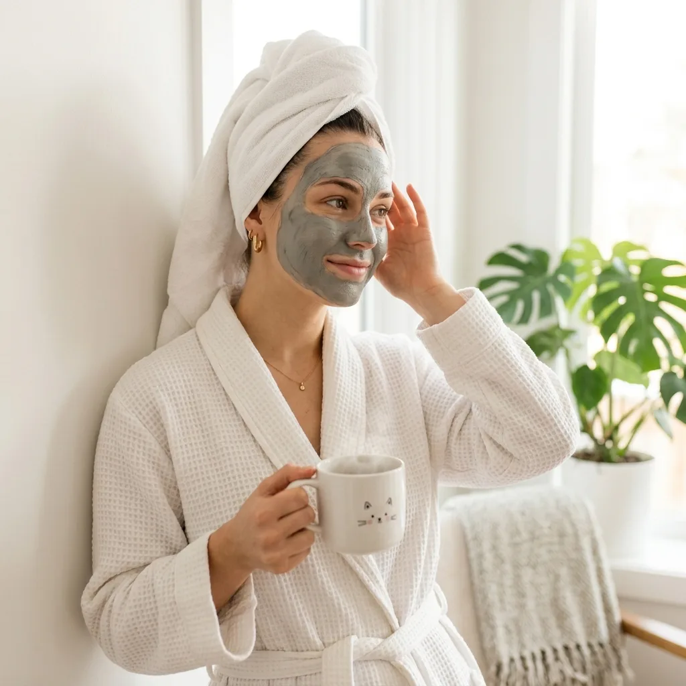

# Young woman enjoying a calm self-care moment

[← Back to the collection](../../README.md) · Category: [Photography](../../gallery/photography.md) · Model: `Vinano Image v2` · ID: `vn-00585`

<a href="https://vinano.ai?utm_source=github&utm_medium=readme&utm_campaign=awesome-image-video-prompts-updating&utm_content=prompt-page-image"></a>

<sub>Preview generated with <a href="https://vinano.ai?utm_source=github&utm_medium=readme&utm_campaign=awesome-image-video-prompts-updating&utm_content=prompt-page-caption">vinano.ai</a></sub>

## Prompt

```text
{
 "image_generation": {
 "subject": {
 "description": "young woman enjoying a calm self-care moment",
 "expression": "relaxed, thoughtful, peaceful",
 "face": "natural facial features a gray clay face mask applied evenly",
 "skin": "natural skin tone, soft texture"
 },
 "hair": {
 "style": "hair wrapped in a white towel turban",
 "appearance": "clean, spa-style look"
 },
 "outfit": {
 "clothing": "white bathrobe",
 "style": "minimal, cozy, spa aesthetic",
 "accessories": "small gold hoop earrings, delicate gold necklace"
 },
 "pose": {
 "hands": "one hand holding a ceramic mug, other hand lightly touching the side of the head",
 "posture": "upright, relaxed stance"
 },
 "props": {
 "mug": "white ceramic mug a cute cat design",
 "theme": "morning relaxation, wellness routine"
 },
 "environment": {
 "setting": "bright indoor space near a window",
 "background": "soft white wall natural window light and leafy green houseplant",
 "mood": "calm, fresh, minimal"
 },
 "lighting": {
 "type": "natural sunlight",
 "direction": "side-lit through a window",
 "effect": "soft shadows, warm highlights"
 },
 "camera": {
 "style": "lifestyle photography",
 "angle": "medium close-up",
 "focus": "sharp focus on subject, softly blurred background",
 "quality": "high-resolution, true-to-life photorealistic"
 },
 "aesthetic": {
 "theme": "self-care, wellness, morning routine",
 "color_palette": "soft whites, neutral tones, natural greens",
 "vibe": "clean, peaceful, luxurious yet minimal"
 }
 }
}

Aim for an editorial, design-driven look with deliberate negative space.
```

## Try it on vinano.ai

1. Copy the prompt above.
2. Open **[vinano.ai](https://vinano.ai?utm_source=github&utm_medium=readme&utm_campaign=awesome-image-video-prompts-updating&utm_content=prompt-page-try)**, paste it into the image generator and pick a model.
3. Swap any placeholders (brand, product, city, person…) for your own details, then generate.

More prompts like this: [Photography gallery](../../gallery/photography.md) · [all categories](../../README.md#contents)
